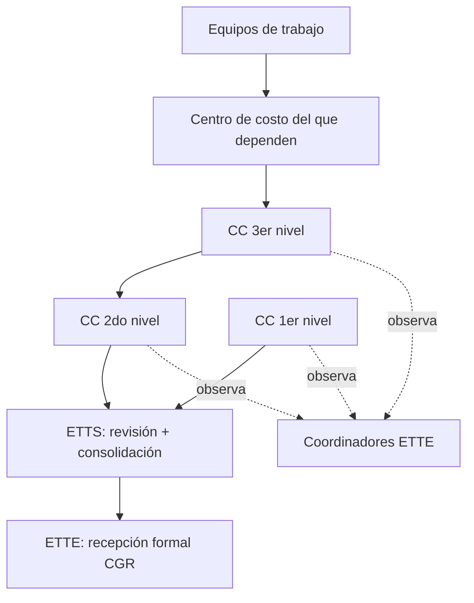

# Plan de mejoras y consolidación del frontend — SIS-TRANSFERENCIA

> **Propósito.** Consolidar lo avanzado, diagnosticar con honestidad qué está
> realmente terminado y qué es cascarón, y trazar una hoja de ruta para hacer el
> frontend **más robusto, consistente e intuitivo** —sin saturar al usuario—, y
> **cerrar los huecos funcionales** pendientes.
>
> **Fecha:** 2026-11-09 · **Estado del backend:** maduro (ver
> [plan-trabajo-backend.md](plan-trabajo-backend.md), bitácora v1.0→v1.6) ·
> **Estado del frontend:** E1–E11 implementadas en estructura, con calidad
> desigual y módulos incompletos.
>
> **Filosofía rectora (confirmada con el usuario):** *intuitivo, no saturado.*
> La ayuda se da **en el momento justo y en la cantidad mínima** (progressive
> disclosure): un placeholder bueno, un tooltip opcional, un ejemplo corto. Nunca
> muros de texto ni instructivos que compitan con el formulario.
>
> **Decisiones de alcance confirmadas (2026-11-09):**
> 1. **Alinear los formularios a la estructura oficial** de los anexos (tablas de
>    filas repetibles), no texto libre. Implica ajustar modelos/migraciones del
>    backend donde haga falta.
> 2. **Generar PDF oficial por anexo (02–06) + acta (07)** con el formato exacto
>    de la directiva, para la entrega física firmable. El backend produce el PDF.
> 3. **Formularios optimizados para captura rápida de muchas filas** (edición en
>    línea tipo tabla, duplicar fila, autocompletado de catálogos, teclado) en los
>    inventarios (03, 04, 06); formulario estructurado por secciones en el 02.

---

## 0. Modelo del proceso y de los anexos (entendimiento validado)

Esta sección fija el entendimiento del negocio que guía todo el plan. Se basa en
[propuesta-directiva.md](propuesta-directiva.md) (disposiciones específicas y
plantillas de anexos) y se cruzó con el modelo de datos real del backend.

### 0.1. Qué emite cada centro de costo

Cada **centro de costo** (= dependencia) produce un **paquete de entrega**:

| Anexo | Contenido | Origen de datos | Obligatorio |
|---|---|---|---|
| **02** Informe de Gestión | Funciones, logros, dificultades, agenda pendiente | **Manual** (narrativo estructurado) | Sí |
| **03** Acervo Documentario | Series documentales por año (físico) + digital | Físico **manual** · Digital ← SGD | Sí |
| **04** Bienes Patrimoniales | Inventario + verificación física | ← **SIGA** (verificar/completar) | Sí |
| **05** Personal a cargo | Relación de servidores + régimen/situación | ← **SGD** (completar) | Sí |
| **06** Bienes No Patrimoniales | Activos no patrimonializados | **Manual** | **No Aplica** permitido |
| Docs. pendientes | Documentos sin atender | ← **SGD** | Sí |
| **07** Acta | Resumen de lo entregado + intervinientes + firmas | **Generado** del paquete | Sí (cierre) |

- El **Anexo 01** (relación de centros de costo) **no lo emite cada dependencia**:
  es el organigrama institucional, transversal, que se consolida al final. En el
  sistema se corresponde con la estructura orgánica ya ingestada del SGD.
- El **Anexo 07 se genera** a partir de la presencia real de los anexos 02–06
  (ya implementado: `presenciaAnexos()` → `anexos_entregados`). Incluye la columna
  "No Aplica" para el 06.

### 0.2. Quién llena y quién remite

- **Encargado del centro de costo** (`responsable_centro_costo`): responsable final;
  **consolida y remite** (`entregas.remitir`).
- **Delegado(s)** (`servidor` con `AsignacionRol` sobre la dependencia): uno o
  varios usuarios designados para **llenar** los anexos. No remiten.
- **Coordinador ETTE** (`coordinador`): **revisa y observa**; no edita anexos.
- **ETTS**: recibe, revisa y consolida institucionalmente el 1er/2do nivel.

> El backend ya soporta este modelo (autorización rol + ámbito). No requiere
> cambios de autorización.

### 0.3. Flujo de remisión y consolidación (Anexo 08)



Cada salto: el nivel inferior **remite** → el superior **consolida** (agrega lo
propio + lo recibido) → remite al siguiente. En cualquier nivel un coordinador
puede **observar** y devolver para subsanación (vuelve a editable). Implementado.

### 0.4. Hallazgo clave — desajuste estructura oficial vs. modelo actual

Al cruzar las **plantillas reales** de la directiva con el esquema del backend:

- **Anexo 02 (`informes_gestion`)**: hoy son 4 columnas `text` planas
  (`principales_funciones`, `logros`, `dificultades`, `asuntos_pendientes`) y el
  formulario usa `textarea` libres. **La directiva lo define como 4 secciones con
  tablas de filas repetibles** (funciones N filas; logros 5 columnas; dificultades
  3 columnas; agenda pendiente 5 columnas). → **Requiere re-modelar** (tablas hijas
  o columnas `jsonb`) y rehacer el formulario como editor de filas. **Sin esto, el
  PDF del Anexo 02 no calza con el formato oficial.**
- **Anexo 03 (`acervo_documental`)**: **ya está bien modelado como filas**
  repetibles (serie, periodo, cantidad, unidad, ubicación). Solo falta la
  **agrupación visual por año** (2023–2026) en el frontend. **No requiere migración.**
- **Anexo 04 (patrimonio)**: la cabecera del formato es el **servidor responsable**
  de los bienes (no solo cada bien). Verificar que el agrupamiento por servidor
  esté disponible para el PDF.
- **Anexos 05 y 06**: ya son filas; revisar que las columnas del formulario cubran
  exactamente las del formato (05: régimen, modalidad, situación, observaciones;
  06: descripción, unidad de medida, cantidad, estado B/R/M, ubicación, obs.).

**Conclusión:** antes de pulir la UX hay que **alinear la estructura de datos y los
formularios al formato oficial** (nueva **Fase 0**). Es prerequisito del PDF oficial
y de una consolidación correcta.

---

## 1. Qué tenemos (consolidación del avance)

### 1.1. Backend (resumen — ya construido y probado)

Laravel 13 · PHP 8.4 · PostgreSQL 16 · monolito modular. **40 tests en verde.**

- **Auth** por DNI (Sanctum, token Bearer). `POST /auth/login`, `GET /auth/me`, `POST /auth/logout`.
- **Ingesta** SGD (organización, servidores, catálogos, acervo digital, documentos
  pendientes) y SIGA (patrimonio). No destructiva (RN-06).
- **Autorización en dos capas:** por **rol** (middleware `permiso:<codigo>`) y por
  **ámbito** (dependencia propia + subárbol). Punto de verdad:
  `User::puedeAccederDependencia()`.
- **Los 7 anexos** con services, requests y rutas.
- **Flujo jerárquico:** remitir → revisar (observar/consolidar) → cierre hacia ETTS.
- **Integridad de edición (RN-13):** 409 al editar una entrega ya remitida.
- **Observaciones/subsanaciones** polimórficas con re-remisión automática.
- **Acta real** (Anexo 07) solo emisible con entrega CONSOLIDADA; evidencias adjuntas.
- **Contrato de API uniforme** (`ApiResponse`): `success/message/data`, paginado con
  `meta`, errores con `errors` en 422. Códigos accionables: 401/403/409/422.

> El backend **no es el cuello de botella**. El trabajo de esta ronda es casi todo
> de frontend. Toca backend solo para: Reportes/exportación (F9, pendiente) y,
> eventualmente, endpoints de ayuda/catálogos si se decide servir textos guía.

### 1.2. Frontend (inventario real por módulo)

Stack: **React 19 · Vite 8 · TypeScript · Tailwind v4 · TanStack Query · axios ·
react-hook-form + zod · sonner**. Primitivas UI propias (estilo shadcn copiado, no CLI).

| Módulo / pantalla | Ruta | Estado real | Nota |
|---|---|---|---|
| Login por DNI | `/login` | ✅ Funcional | Validación zod espejo del backend |
| Dashboard | `/` | ✅ Funcional | + `TableroOperativoView` |
| Estructura orgánica (Anexo 01) | `/organigrama` | 🟡 Parcial | Árbol; falta pulir UX |
| Anexo 02 · Gestión | `/gestion` | 🟢 Alineado (F0+F4) | Secciones I–IV tipo tabla (`SeccionFilas`); migrado a `AnexoLayout`; hints + «faltan: X» |
| Anexo 03 · Acervo | `/acervo` | 🟢 F3+F4 | Sobre `AnexoCrudPage`; `Select` + catálogos; toggle Lista / **Por año** |
| Anexo 04 · Patrimonio | `/patrimonio` | 🟢 F4 | Verificación **inline** (fila expandible, sin modal) + campos SIGA; toggle Lista / **Por servidor** |
| Anexo 05 · Personal | `/personal` | 🟢 Migrado F3 | Sobre `AnexoCrudPage`; regímenes/situación desde `catalogos.ts` |
| Anexo 06 · No patrimonial | `/nopatrimonial` | 🟢 Migrado F3 | Sobre `AnexoCrudPage`; estados/unidades desde `catalogos.ts` |
| Documentos pendientes (SGD) | `/documentos` | 🟡 Funcional | — |
| Observaciones | `/observaciones` | 🟡 Funcional | Usa `confirm()` nativo |
| Entregas / flujo | `/entregas` | 🟡 Parcial | Árbol + bandeja; a validar e2e |
| Anexo 07 · Acta | `/acta` | 🟡 Parcial | Imprimible OK; firma = seam |
| **Reportes** | `/reportes` | ❌ **Cascarón** | Solo placeholder visual, sin datos |
| Usuarios / Admin | `/usuarios` | 🟡 Funcional | Activación de cuentas |

**Leyenda:** ✅ terminado y pulido · 🟡 funciona pero con deuda de robustez/UX ·
❌ no implementado (placeholder).

> **Corrección importante al registro histórico:** la bitácora de
> [plan-frontend.md](plan-frontend.md) marca E1–E11 como "completadas y en
> producción". En la práctica **la estructura existe pero la calidad es desigual**
> y hay módulos sin construir (Reportes). Este plan toma el estado *real* del
> código como línea base, no la bitácora.

---

## 2. Diagnóstico técnico (deuda concreta encontrada en el código)

Hallazgos verificados leyendo el código, agrupados por las cuatro áreas que el
usuario priorizó.

### 2.1. Robustez de componentes

- **Primitivas UI incompletas.** Hay `button, input, label, card, dialog, badge,
  pagination, skeleton, spinner, textarea`. **Faltan** como primitivas accesibles
  y reutilizables: **Select**, **Tooltip**, **ConfirmDialog**, **Combobox/Autocomplete**
  (para dependencias/servidores), **EmptyState**, **FormField** (label+control+error+hint
  en un solo lugar), **DataTable** genérica, **FieldError/FormError**.
- **Controles nativos sin estilizar ni accesibilizar.** Los `<select>` HTML crudos
  (p. ej. `AcervoModal`, verificación de patrimonio) rompen la coherencia visual,
  no soportan búsqueda y no están alineados con el tema oscuro.
- **`confirm()` / `alert()` nativos** del navegador (p. ej. desestimar observación
  en `ObservacionesAnexoPanel`). Son bloqueantes, no accesibles, no tematizables y
  se sienten fuera del sistema. → reemplazar por `ConfirmDialog`.
- **Validación cliente parcial y no centralizada.** Cada modal define su propio
  `zodSchema` inline con reglas que no siempre reflejan el backend (longitudes,
  DNI 8 dígitos, código patrimonial 12 dígitos, enums). No hay un módulo
  `src/lib/validation/` con esquemas compartidos ni mapeo automático de errores
  422 → campos (hoy se hace a mano y de forma inconsistente).
- **Manejo de estados carga/vacío/error no uniforme.** Cada página reimplementa
  spinners y vacíos con markup distinto. No hay un contrato común
  (`<AsyncBoundary>` / `<QueryState>`). El `ErrorBoundary` global existe pero no
  cubre errores de *data fetching* por sección.
- **Catálogos hardcodeados en componentes** (regímenes laborales, unidades de
  conservación, estados de conservación). Deberían vivir en `src/lib/catalogos.ts`
  (o venir del backend) y reutilizarse.

### 2.2. Consistencia visual / UX

- **Patrón de anexo duplicado, no abstraído.** El plan prometía "construir una vez
  (E4) y replicar". En la práctica cada `*Page.tsx` repite a mano cabecera, alerta
  de bloqueo, filtros, tabla, modal y panel de observaciones. Hay componentes
  compartidos (`AnexoHeader`, `AlertaBloqueoEntrega`, `ObservacionesAnexoPanel`)
  pero **no un contenedor `<AnexoLayout>` ni un `<AnexoCrudPage>`** que elimine la
  repetición. Esto hace que mejorar la UX obligue a tocar N páginas.
- **Colores institucionales inconsistentes.** Conviven tokens de tema
  (`text-primary`, `bg-muted`) con hex sueltos (`#3484A5`, `bg-emerald-600`,
  `bg-slate-50`). No hay una paleta institucional única como tokens.
- **Densidad y tipografía variables** entre páginas (tamaños `text-xs/text-[10px]/
  text-[11px]` mezclados ad hoc).
- **Tema oscuro parcial.** Algunas clases con hex fijo no responden al tema.
- **Responsive desigual.** Las tablas anchas (Patrimonio, Personal) no tienen un
  patrón consistente de scroll/colapso en móvil.

### 2.3. Usabilidad y ayuda al usuario (sin saturar)

- **Falta orientación en el momento justo.** Los formularios tienen `placeholder`
  decentes, pero no hay **tooltips de ayuda opcionales** por campo (ícono "?" que
  el usuario abre si lo necesita), ni **ejemplos** embebidos, ni microcopy que
  explique *por qué* se pide un dato.
- **Sin señalización de progreso por anexo.** El usuario que llena no ve de un
  vistazo "este anexo está vacío / a medias / completo / observado". El dashboard
  insinúa esto pero las páginas de anexo no refuerzan el estado ni **qué falta**.
- **Estados vacíos poco accionables.** Varios vacíos dicen "sin registros" pero no
  invitan a la acción correcta ("Registrar el primer bien", "Importar desde SIGA").
- **Errores poco claros.** Los 409/422/403 a veces se muestran como toast genérico.
  El 409 (RN-13) es *información accionable* y debe explicarse ("La entrega ya fue
  remitida; para editar, el revisor debe observarla").
- **Sin confirmaciones suaves para acciones de alto impacto** (remitir, consolidar,
  eliminar) con resumen de consecuencias.
- **Primera vez sin brújula.** No hay un onboarding ligero ni un "¿qué hago ahora?"
  contextual según rol y estado (opcional y descartable, no intrusivo).

### 2.4. Huecos funcionales

- **Reportes (`/reportes`): no existe.** Es solo un placeholder. Requiere backend
  (F9: PDF/Excel) + frontend.
- **Exportación / impresión de anexos.** El acta imprime; los demás anexos no tienen
  "exportar a PDF/Excel" para entrega física (la directiva exige soporte físico).
- **Firma digital:** seam documentado, sin proveedor. Fuera de alcance salvo decisión.
- **Entregas:** el flujo existe pero conviene validarlo end-to-end con datos reales y
  pulir la bandeja del revisor y el árbol.
- **Anexo 01 / Estructura orgánica:** revisar si cubre el formato de la directiva
  (relación de centros de costo) y su navegación.

---

## 3. Principios de diseño para esta ronda

1. **Ayuda bajo demanda, no por defecto.** Campo → `label` claro + `placeholder`
   con ejemplo. La explicación larga vive tras un ícono de ayuda (`Tooltip` /
   `Popover`) que el usuario abre si quiere. Nada de párrafos sobre el formulario.
2. **Un patrón, replicado por composición.** Toda la UX de anexo se mejora en un
   solo lugar (`<AnexoLayout>` + `<AnexoCrudPage>` + `<DataTable>`), y las páginas
   se vuelven configuración, no copia.
3. **El sistema guía el "qué sigue".** Estado visible por anexo (vacío/parcial/
   completo/observado) y una sola acción primaria evidente por pantalla.
4. **Errores que enseñan.** 401/403/409/422 traducidos a lenguaje del usuario, con
   la acción correcta. El 409 nunca se oculta: se explica.
5. **Accesible y temático por defecto.** Todo control es navegable por teclado,
   con foco visible, `aria-*` correcto, y responde a claro/oscuro vía tokens.
6. **Tipado estricto en la frontera.** Cero `any` en respuestas; esquemas zod
   compartidos que son espejo verificado del backend.

---

## 4. Hoja de ruta por fases

Orden pensado para que cada fase **deje una base que la siguiente aprovecha**.
Las fases F1–F3 son fundaciones transversales (pagan deuda en todas las páginas);
F4–F6 son aplicación y cierre de huecos.

### F0 — Alineación estructural anexo↔formato oficial *(prerequisito, cruza backend+frontend)*

Alinear el modelo de datos y los formularios a las plantillas de la directiva.
**Debe ir primero**: condiciona el PDF oficial (F5) y la UX de captura (F4).

- **Anexo 02 — re-modelar a secciones con filas repetibles:**
  - Backend: migrar `informes_gestion` de 4 `text` planos a estructura de filas.
    Dos opciones a decidir (§5): (a) **tablas hijas** (`informe_funciones`,
    `informe_logros`, `informe_dificultades`, `informe_pendientes` con FK al
    informe) — más consultable y reportable; (b) **columnas `jsonb`** (arrays de
    objetos) — menos migraciones, PostgreSQL lo soporta nativo. *Recomendación:
    jsonb* por velocidad, dado que no se filtran esos sub-ítems individualmente.
  - Migración de datos: el texto libre existente se conserva (p. ej. como una
    primera fila "texto heredado") para no perder lo ya capturado.
  - Service/Request/tests actualizados; contrato de API versionado.
- **Anexo 03 — agrupación por año** en el frontend (sin migración); validar que el
  `periodo`/año permita agrupar 2023–2026 como el formato.
- **Anexos 04/05/06 — auditoría de columnas**: comparar campo por campo el
  formulario y el modelo contra la plantilla oficial; completar faltantes
  (p. ej. en 04: color, dimensión, características, código anterior, ubicación;
  cabecera por servidor responsable).
- **Mapa anexo→plantilla** documentado (qué campo del sistema corresponde a qué
  celda del formato) — insumo directo para el generador de PDF (F5).

**Entregable:** cada anexo del sistema corresponde 1:1 con su formato oficial;
backend con tests verdes; contrato de API listo para los formularios de F4 y el
PDF de F5.

### F1 — Núcleo de primitivas robustas y accesibles *(fundación)*

Construir/endurecer las primitivas que faltan, todas con teclado + aria + tema:

- `Select` (accesible, con búsqueda opcional) y `Combobox/Autocomplete`
  (dependencias, servidores, catálogos).
- `Tooltip` / `Popover` (base de la ayuda contextual).
- `ConfirmDialog` (reemplaza todo `confirm()`/`alert()` nativo).
- `FormField` (compone `Label` + control + `hint` + `error` + estado requerido) y
  `FieldError`.
- `EmptyState` (ícono + título + descripción corta + acción primaria).
- `DataTable` genérica (columnas tipadas, estados de carga/vacío/error, paginación
  integrada con la `<Pagination>` existente, scroll horizontal controlado).
- `AsyncBoundary` / `QueryState` (contrato único carga/vacío/error para TanStack
  Query).
- **`RowEditor` / `EditableTable`** — editor de filas repetibles para captura
  rápida (agregar/duplicar/eliminar fila, edición en línea, navegación por
  teclado Tab/Enter, autocompletado de catálogos por celda). Es la primitiva que
  habilita los formularios de anexos tipo tabla (02, 03, 06) de F4.

**Entregable:** catálogo de primitivas documentado; cero controles nativos sin
estilizar en el código nuevo. Build + lint verdes.

### F2 — Sistema de diseño y tokens institucionales *(fundación)*

- Definir la **paleta institucional** como tokens (claro/oscuro) en `index.css`:
  primario (el `#3484A5` que ya se usa), éxito, advertencia, peligro, neutrales.
- Erradicar hex sueltos → reemplazar por tokens (`bg-primary`, `text-success`, …).
- Escala tipográfica y de densidad consistente (dejar de mezclar `text-[10/11px]`).
- Verificar tema oscuro en todas las pantallas.
- Patrón responsive único para tablas anchas.

**Entregable:** una sola fuente de verdad visual; tema oscuro coherente; sin hex
mágicos. (Puede apoyarse en la skill `dataviz` para la paleta accesible.)

### F3 — Patrón de anexo real (abstracción) + manejo de errores unificado *(fundación)* ✅ EJECUTADA (2026-11-10)

- ✅ `<AnexoLayout>` (`components/anexos/AnexoLayout.tsx`): cabecera (`AnexoHeader`) +
  `EstadoAnexoChip` (indicador de estado) + `AlertaBloqueoEntrega` + slot de
  contenido + `ObservacionesAnexoPanel`, en un contenedor único. Resuelve también
  el guard de «seleccione centro de costo» que cada página reimplementaba.
- ✅ `<AnexoCrudPage>` (`components/anexos/AnexoCrudPage.tsx`): patrón declarativo
  para anexos de listado. Recibe columnas, filtros, datos, hooks y el modal
  (render-prop); aplica automáticamente el bloqueo por estado (`esModificable`),
  permisos (`<Can>`), estados carga/vacío/error (`DataTable`), la columna de
  acciones editar/eliminar y la **confirmación suave** de borrado (`useConfirm`,
  no `confirm()` nativo).
- ✅ **Mapa único de errores API → UI** (`lib/api-errors.ts`): `mensajeDeError`
  (401/403/409/422/red → copy ES accionable), `notificarError` (toast; omite 401 y
  422), y `aplicarErroresAFormulario(error, setError)` que mapea los `errors` de un
  422 al campo exacto de react-hook-form. **Corrige un bug latente:** los `use-*.ts`
  leían `error?.response?.data?.message` (forma cruda de axios) que el interceptor
  ya había normalizado → rama muerta, el usuario veía el mensaje genérico.
- ✅ `src/lib/catalogos.ts`: regímenes laborales, situación laboral, tipos de
  acervo, unidades de conservación, estados de conservación, unidades de medida,
  en un solo lugar (+ helper `aOpcionesSelect`).
- ✅ **Migradas como prueba del patrón:** Acervo (03), Personal (05), No
  Patrimonial (06) — página + modal. Eliminados ahí: `confirm()` nativos,
  `<select>` crudos (→ `Select`), catálogos hardcodeados, markup de tabla a mano,
  mapeo de errores inconsistente. 422 cableado al campo en los 3 modales.

**Entregable:** las páginas de anexo pasan a ser configuración; mejorar UX = tocar
un sitio. Errores consistentes en toda la app. Build (prod+dev) + typecheck + lint
verdes (sin warnings nuevos). **Pendiente de adopción (barrido posterior):** las
páginas fuera de alcance de esta ronda (documentos, patrimonio, acta, admin,
entregas, gestión, observaciones) aún usan el `response?.data` muerto y no pasan
por `AnexoCrudPage`; migrarlas es trabajo mecánico de F4/F6.

### F4 — Capa de usabilidad y ayuda contextual *(aplicación — el corazón del pedido)*

> **Avance (2026-11-10) — corte «vertical 02 + ayuda/estado en migrados» EJECUTADO.**
> Build+typecheck+lint verdes (sin warnings nuevos). Hecho en esta ronda:
> - ✅ **Anexo 02** migrado a `AnexoLayout` (header + `EstadoAnexoChip` + alerta +
>   observaciones + guard), conservando sus 4 `SeccionFilas` (ya tipo tabla desde
>   F0) y los botones borrador/completado. Se añadió `hint` por sección y
>   `IndicadorFaltantes` («Faltan: una función principal, un logro…»). El estado
>   propio del informe (borrador/completado) queda como chip aparte en la Sección I.
> - ✅ **Ayuda por campo bajo demanda** (`FormField hint` → `HelpTooltip`) en los
>   modales 03/05/06: formato de acervo, serie documental, unidad de conservación,
>   régimen/situación laboral, denominación no patrimonial, estado de conservación.
> - ✅ **Microcopy/ejemplos** en placeholders revisados con lenguaje de servidor
>   público; nueva primitiva `components/anexos/IndicadorFaltantes.tsx`.
> - ✅ **Vacíos accionables + confirmaciones suaves + errores traducidos** ya venían
>   de F3 (`AnexoCrudPage` + `api-errors`); verificados en los 3 anexos.
>
> **Avance (2026-11-10) — corte 2: Anexo 03 por año EJECUTADO.**
> - ✅ **Anexo 03 agrupado por año** (`AcervoPorAnio` + helper `agrupar-por-anio.ts`):
>   toggle Lista/Por año en el Acervo; cada año es sección colapsable con sus
>   series. El año se deriva sin tocar backend (`anio` → `desde_anio` → primer año
>   del texto `periodo` → «Sin año»); orden desc; no se hardcodea 2023–2026.
> - ✅ **`AnexoCrudPage` extendido** con prop `vistaAlternativa(handlers)` — un
>   render-prop que reemplaza el cuerpo de tabla conservando todo el marco
>   (header, chip, alerta, filtros, modal, observaciones) y expone
>   `abrirAlta`/`abrirEdicion`. Reutilizable para el 04 «por servidor».
> - ✅ La vista por año trae todas las series (`per_page` alto) y agrupa en cliente;
>   borrado con confirmación suave (`useConfirm`); aviso discreto si el total del
>   servidor supera lo cargado.
>
> **Avance (2026-11-10) — corte 3: Anexo 04 verificación inline EJECUTADO.**
> - ✅ **Verificación sin modal, en la misma tabla** (`FilaVerificacionPatrimonio`):
>   al pulsar «Verificar/Editar» la fila se **despliega** y muestra un sub-formulario
>   dentro de la tabla (resultado, estado de conservación y los **campos SIGA que se
>   completan al verificar**: ubicación, color, dimensión, características, código
>   anterior + observación con sustento obligatorio RN-05). Guarda en línea y colapsa.
>   Botón con chevron (`aria-expanded`); `VerificarBienModal` eliminado.
> - ✅ **`<select>` nativos → `Select` accesible** (filtro de estado + sub-formulario)
>   y `use-patrimonio` migrado a `notificarError` (bug `response?.data` muerto corregido).
> - Decisión de UX (usuario): completar en la propia fila es más fluido que abrir un
>   modal; se mantiene el resumen SIGA, filtros y paginación de la página intactos.
>
> **Avance (2026-11-10) — corte 4: F4 COMPLETA.**
> - ✅ **Anexo 04 agrupado por servidor responsable** (`agrupar-por-servidor.ts` +
>   toggle Lista/Por servidor en PatrimonioPage): cada custodio es una cabecera de
>   grupo sobre las mismas filas (la verificación inline sigue funcionando). La fila
>   de bien se extrajo a `renderFilaBien` reutilizable; aviso si hay más páginas.
> - ✅ **«¿Qué sigue?» contextual** (`components/anexos/QueSigueCard.tsx`): una sola
>   sugerencia prioritaria, **descartable**, derivada del estado real de la entrega
>   y los anexos (observada→subsanar; consolidada→acta; borrador→primer anexo
>   incompleto o remitir; remitida/en_revision→nada). Montada en el DashboardPage.
>
> **F4 cerrada.** Pendiente menor (opcional, puede ir en F6): microcopy de
> documentos. Siguiente fase: **F5** (PDF oficial por anexo + Reportes + paquete).

Sobre las fundaciones anteriores, y respetando *intuitivo, no saturado*:

- **Formularios de anexo alineados al formato oficial (usando `RowEditor`):**
  - **Anexo 02:** secciones I–IV con tablas de filas repetibles (funciones;
    logros con actividad/resultado/indicador/verificación; dificultades;
    agenda pendiente). Reemplaza los `textarea` libres actuales.
  - **Anexo 03:** captura rápida agrupada por año (2023–2026), con autocompletado
    de series documentales y tipos de unidad de conservación.
  - **Anexos 04/05/06:** captura/verificación en línea; en 04 agrupado por servidor
    responsable; en 06 estado B/R/M como control compacto.
  - Patrón: **una fila = un ítem**; duplicar fila para series repetitivas; pegar
    desde Excel si es viable (nice-to-have).
- **Ayuda por campo bajo demanda:** ícono de ayuda junto al label que abre un
  `Tooltip/Popover` con una frase y, si aplica, un ejemplo. Definir el texto de
  ayuda como dato (`hint`) en la config de cada campo, no en el JSX.
- **Microcopy y ejemplos** en placeholders y descripciones, revisados anexo por
  anexo con lenguaje de servidor público (no técnico).
- **Estado del anexo siempre visible:** chip vacío/parcial/completo/observado y,
  cuando falte algo obligatorio, un "faltan: X, Y" discreto.
- **Estados vacíos accionables** con la acción correcta por anexo.
- **Confirmaciones suaves** (vía `ConfirmDialog`) para remitir / consolidar /
  eliminar, con un resumen de 1–2 líneas de la consecuencia.
- **Traducción de errores accionables** (especialmente 409 RN-13 y 403 fuera de
  ámbito) a mensajes que digan *qué hacer*.
- **"¿Qué sigue?" contextual** opcional y descartable en el dashboard, según rol y
  estado de la entrega (una sola sugerencia, no un tour).

**Entregable:** un usuario no técnico completa su anexo sin manual, con ayuda solo
cuando la pide. Sin saturación visual.

### F5 — Cierre de huecos funcionales *(aplicación)*

> **EJECUTADA (2026-11-10).** Primera fase que toca backend además del frontend.
> Decisiones §5.2 confirmadas con el usuario: Reportes MVP = los 3 (matriz+avance,
> conciliación patrimonial, observaciones); **Excel primero** (`maatwebsite/excel`),
> PDF después; motor **`barryvdh/laravel-dompdf`**; PDF de anexos 02–06 generable
> **siempre** (marca de agua «BORRADOR» si la entrega no está consolidada), acta 07
> y paquete completo exigen CONSOLIDADA. **60 tests backend verdes** (42 base + 18
> F5), `npm run build` + `tsc` verdes, pint limpio, sin lint nuevos.
>
> **1) PDF oficial 02–06 + acta 07 (vertical 02 primero, luego replicado).**
> - Soporte compartido: `Support\Services\PdfService` (envuelve dompdf: stream +
>   binario), `Support\Services\ContextoTransferencia` (proceso activo + estado de
>   entrega + noción de «borrador» para la marca de agua), layout Blade único
>   `resources/views/pdf/layout.blade.php` (cabecera/pie institucional, marca de
>   agua BORRADOR) y **partials** `pdf/partials/anexo0{2..6}.blade.php` reutilizados
>   por el PDF individual y el expediente (una sola fuente de verdad del formato).
> - Un generador por anexo (`InformeGestionPdf`, `AcervoPdf`, `PatrimonioPdf`,
>   `PersonalPdf`, `NoPatrimonialPdf`, `ActaPdf`), cada uno con `datos()` (modelo de
>   vista) + `descargar()`. 04 agrupa por servidor responsable; 03 por año; 06 con
>   estado B/R/M (`EstadoConservacion::siglaBRM()`). Acta reutiliza
>   `TransferenciaService::obtenerActa` (gate 409 CONSOLIDADA).
> - Endpoints `GET /{anexo}/pdf?dependencia_id=` gated `permiso:anexos.ver` + ámbito;
>   `GET /transferencia/acta/pdf` gated `actas.generar`. Descarga autenticada en
>   frontend vía `lib/descargas.ts` (Blob+Bearer, decodifica errores-blob a
>   `ApiError`) + primitiva `components/anexos/BotonDescargarPdf`; botón «PDF oficial»
>   en las 6 páginas (02–06 + acta). `AnexoCrudPage` ganó prop `accionesExtra`.
>
> **2) Reportes (`/reportes`) — cascarón → real.** Módulo `App\Modules\Reportes`:
> `ReportesService` (matriz de anexos+avance, conciliación patrimonial,
> observaciones; reutiliza el tablero operativo; todo acotado al ámbito),
> `ReportesController` (JSON `GET /reportes/{reporte}` gated `reportes.ver` +
> export `GET /reportes/{reporte}/export?formato=excel|pdf` gated
> `reportes.exportar`), exportadores `maatwebsite/excel` y PDF genérico
> `pdf/reporte.blade.php`. Frontend: `ReportesPage` con 3 pestañas, KPIs,
> `DataTable` y botones Excel/PDF (`BotonesExport`, gated).
>
> **3) Paquete de entrega.** `App\Modules\Expediente\Services\ExpedientePdf` compone
> un único PDF con todos los anexos presentes (reutiliza `datos()` de cada generador
> + partials, página por anexo), exige CONSOLIDADA (409). Endpoint
> `GET /expediente/pdf` gated `expediente.ver`; botón «Expediente completo» en la
> página del Acta.
>
> **No incluido en este corte (queda para F6):** validación e2e del flujo de
> Entregas con datos reales y alineación del Anexo 01 / Estructura orgánica.

- **PDF oficial por anexo (02–06) + acta (07)** — *objetivo confirmado*:
  - Backend genera cada anexo con el **formato exacto de la directiva** (maqueta
    fiel: cabeceras, tablas, numeración, bloques de firma), apoyándose en el
    *mapa anexo→plantilla* de F0. Librería sugerida: `barryvdh/laravel-dompdf`
    (o `spatie/laravel-pdf` con Blade + Chromium si se requiere fidelidad alta).
  - Endpoints `GET /.../{anexo}/pdf?dependencia_id=`; descarga autenticada vía
    Blob + Bearer en frontend (igual que `descargarEvidencia` del Acta).
  - El acta (07) ya tiene vista imprimible; unificarla al generador PDF del backend
    para consistencia de formato y firma.
- **Reportes (`/reportes`)** — requiere backend (F9) y frontend:
  - Backend: endpoints de consolidado (matriz de anexos por dependencia, avance,
    observaciones, conciliación patrimonial) y **exportación PDF/Excel**
    (`maatwebsite/excel` para Excel).
  - Frontend: filtros por ámbito/dependencia, tablas/resúmenes y botones de
    descarga.
- **Paquete de entrega completo:** opción de descargar/imprimir **todos los anexos
  de una dependencia** como un solo expediente PDF para la entrega física firmable.
- **Entregas:** validación e2e del flujo remitir→revisar→consolidar→ETTS con datos
  reales; pulir bandeja del revisor y árbol.
- **Anexo 01 / Estructura orgánica:** alinear al formato de la directiva.

**Entregable:** no quedan pantallas-cascarón; la transferencia puede producir sus
entregables físicos/digitales.

### F6 — Pulido final, accesibilidad y QA *(cierre)*

- Auditoría de accesibilidad (teclado, foco, contraste, `aria`), responsive en
  móvil/tablet, revisión de textos (ortografía institucional).
- Revisión global de manejo de sesión (401), ámbito (403), integridad (409).
- Pruebas manuales guiadas por rol (servidor, responsable, coordinador, ETTS, admin).
- `npm run build` + `npm run lint` verdes; (opcional) tests de componentes clave.
- Documentar variables de entorno y despliegue (ya hay README; actualizar).

**Entregable:** frontend consistente, accesible y listo para operación real.

---

## 5. Decisiones abiertas (a confirmar antes de ejecutar cada fase)

0. **Anexo 02 — tablas hijas vs. `jsonb` (F0):** ¿se modelan funciones/logros/
   dificultades/pendientes como tablas hijas (más consultable/reportable) o como
   columnas `jsonb` (menos migraciones)? → Recomendación: **jsonb**, salvo que
   Reportes necesite filtrar o agregar por sub-ítem individual.
1. **Origen de los textos de ayuda (F4):** ¿se escriben en el frontend (rápido) o
   se sirven desde el backend (editables sin desplegar)? → Recomendación: empezar
   en frontend (`hint` por campo) y migrar a backend solo si se necesita editarlos.
2. **Reportes (F5):** ¿qué reportes son indispensables para la entrega física y
   cuáles son "nice to have"? ¿Formato prioritario PDF o Excel? → Definir el
   mínimo viable (matriz de anexos + avance por dependencia) primero.
3. **Firma digital:** sigue fuera de alcance salvo que se defina proveedor
   (PKI/RENIEC). Mantener el seam.
4. **Paleta institucional (F2):** confirmar colores oficiales de la Municipalidad
   (hoy se infiere `#3484A5` + franja andina). Pedir el manual de marca si existe.
5. **Combobox de dependencias/servidores:** con 107–157 dependencias y 645
   servidores, el `Select` simple no basta; confirmar `Combobox` con búsqueda
   (y, si crece, búsqueda server-side).

---

## 6. Secuencia recomendada y por qué

```
F0 (alineación estructura↔formato oficial · backend+frontend)
          │
          ▼
F1 (primitivas, incl. RowEditor) ──► F2 (tokens) ──► F3 (patrón anexo + errores)
                                                            │
                                                            ▼
                                        F4 (usabilidad/ayuda + formularios tabla)
                                                            │   ◄── el pedido central
                                                            ▼
                                        F5 (PDF oficial + Reportes + paquete)
                                                            │
                                                            ▼
                                                      F6 (pulido/QA)
```

**F0 primero**: alinea datos y formato oficial; sin ella el PDF (F5) y los
formularios tipo tabla (F4) no tendrían dónde apoyarse. **F1–F3** son fundaciones
transversales: pagan deuda una vez y hacen que F4 (la mejora de usabilidad que
pide el usuario) se aplique **a todas las pantallas desde un solo lugar**, en vez
de retocar 13 páginas a mano. **F5** produce los entregables oficiales; **F6**
asegura calidad.

> Las fases pueden solaparse por anexo: p. ej. completar F0→F4→F5 del Anexo 02 de
> punta a punta como **vertical de referencia** antes de replicar en los demás
> (igual que E4 fue el ejemplar en el plan original).

> **Nota de método.** Este documento es el plan; **no se ha tocado código**. La
> ejecución arranca por F1 cuando el usuario lo apruebe, confirmando antes las
> decisiones abiertas de §5 que afecten a esa fase.
