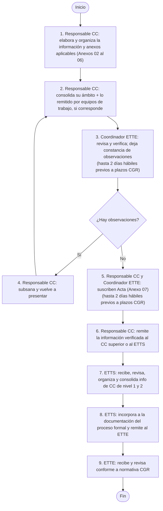
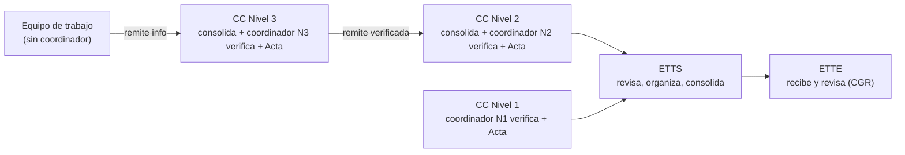

# Consolidado de requerimientos y flujo — Directiva N° 00X-2026-MDSJ/GM

**Directiva:** Lineamientos para la Transferencia Administrativa de Gestión y Entrega de Cargo a nivel de Centros de Costo — Municipalidad Distrital de San Jerónimo
**Versión de la directiva:** 0.0 (proyecto, fecha del archivo: 13/11/2026)
**Propósito de este documento:** servir de línea base para contrastar el sistema implementado contra lo que la directiva exige (funcionalidades, reglas y, sobre todo, el flujo).

> **Convenciones**
> - **[EXPL]** = lo dice la directiva de forma explícita (se cita el numeral).
> - **[INF]** = lo inferí para que sea implementable; hay que confirmarlo.
> - **[VACÍO]** = la directiva no lo define o es ambiguo (ver sección 11).
> - Columna **Estado**: ⬜ pendiente de revisar · ✅ cumple · 🟡 parcial · ❌ no cumple · ➖ no aplica.

---

## 1. Resumen ejecutivo

La directiva regula un **procedimiento interno** (no sustituye el proceso formal de Transferencia de Gestión de la CGR, Ley 30204 y Directiva 016-2022-CG/PREVI). Cada responsable de un centro de costo (CC) elabora un paquete de información (Informe de Gestión + 4 anexos de registro), lo **consolida hacia arriba** por la jerarquía de CC, un **coordinador acreditado por el ETTE** lo revisa y verifica, ambos **suscriben el Acta (Anexo 07)**, y la información sube al **ETTS**, que la incorpora al proceso formal y la remite al **ETTE**.

Lo que define el sistema:

1. Una **jerarquía de CC** (Anexo 01) que determina a quién se remite cada paquete.
2. **Cinco formatos** (Anexos 02–06) más el **Acta** (Anexo 07).
3. Un **ciclo de revisión con observaciones** (revisar → observar → subsanar → volver a revisar) hasta que no haya observaciones.
4. **Plazos relativos a la CGR**: hasta 2 días hábiles *antes* de los plazos CGR.
5. **Roles**: Responsable de CC, Coordinador acreditado por el ETTE, ETTS, ETTE, Oficina de Gestión Patrimonial, OPM/OGPP, GM, OTI.

---

## 2. Actores y roles

| Rol | Quién es | Qué hace en el procedimiento | Fuente |
|---|---|---|---|
| **Responsable del CC** | Funcionario/servidor responsable de un CC del Anexo 01 (cualquier régimen laboral) | Elabora, organiza, verifica y presenta información; consolida la de sus dependientes; subsana observaciones; suscribe el Acta como quien entrega; remite hacia arriba | 5.1, 8.2–8.4, 9.2 |
| **Responsable de Equipo de Trabajo** | Responsable de un CC que es "equipo de trabajo" | Elabora y remite su información al CC del que depende. **No** tiene coordinador ni verificación individual | 7.7.2, 8.1 |
| **Coordinador acreditado por el ETTE** | Persona acreditada por el responsable del ETTE, asignada a CC de nivel 1, 2 o 3 | Revisa y verifica; deja constancia de observaciones; las comunica; informa al responsable del ETTE; suscribe el Acta como quien recibe/verifica | 7.7, 8.6 |
| **Responsable del ETTE** | Designado por el Titular Entrante | Acredita coordinadores, programa reuniones, dispone reemplazos, recibe informes de los coordinadores | 7.6, 7.7, 7.8.3, 8.6 |
| **ETTS** | Equipo del Titular Saliente (mín. 3 personas), dirigido por el funcionario Responsable | Recibe info de CC de nivel 1 y 2, revisa, organiza, consolida, incorpora al proceso formal y remite al ETTE; coordina reemplazo de responsable de CC impedido | 8.3.3, 8.4.3, 8.5, 7.8.2 |
| **ETTE** | Equipo del Titular Entrante (mín. 3 personas, pueden ser ciudadanos) | Recibe la documentación del ETTS y la revisa conforme a normativa CGR | 8.6.4 |
| **Oficina de Gestión Patrimonial** | CC 11.05 | Entrega información patrimonial para el Anexo 04 y comunica inconsistencias; coordina devolución de bienes del personal contratado | 5.5, 8.8, 9.6 |
| **Gerencia Municipal (GM)** | CC 03 | Evalúa situaciones no previstas; gestiona publicación/difusión con OTI | 5.2, 9.1, 10.1 |
| **OGPP / OPM** | CC 07 / 07.02 | Seguimiento de la aplicación; propone mejoras | 5.3, 10.2 |
| **OTI** | CC 07.05 | Publicación en portal institucional | 5.2, 10.1 |

---

## 3. Jerarquía de centros de costo y reglas de ruteo

### 3.1 Niveles
- **Nivel 1, 2 y 3:** unidades de organización del ROF [EXPL 7.1 i)].
- **Equipo de trabajo:** unidad funcional identificada como CC en el Anexo 01 [EXPL 7.1 c), f)].

### 3.2 A quién remite cada nivel (tabla de ruteo)

| CC que entrega | Quién revisa/verifica | Con quién firma el Acta | Remite a | Fuente |
|---|---|---|---|---|
| **Equipo de trabajo** | Nadie individualmente; se revisa dentro de la información consolidada del CC padre | Constancia o acta con el responsable del CC del que depende | CC del que depende | 7.5.3, 7.7.2, 8.1, 8.7.3 |
| **Nivel 3** | Coordinador ETTE asignado a nivel 3 | Coordinador ETTE | CC de **nivel 2** del que depende | 8.2.4–8.2.5, 8.7.2 |
| **Nivel 2** | Coordinador ETTE asignado a nivel 2 | Coordinador ETTE | **ETTS** | 8.3, 8.7.2 |
| **Nivel 1** | Coordinador ETTE asignado a nivel 1 | Coordinador ETTE | **ETTS** | 8.4, 8.7.2 |
| **Sin CC superior inmediato previsto** | (según nivel) | — | CC del que dependa funcional u organizacionalmente, dejando constancia | 9.4 |
| **CC padre sin responsable designado** (para equipos de trabajo) | — | — | Responsable del nivel organizacional superior, con constancia de la circunstancia; y se comunica a la instancia competente | 9.5 |

### 3.3 Consolidación
- Nivel 3 consolida: equipos de trabajo bajo su dependencia + su propio ámbito [EXPL 8.2.4].
- Nivel 2 consolida: CC de nivel 3 bajo su dependencia + su propio ámbito, verificando que esté **completa conforme a los anexos aplicables** [EXPL 8.3.1].
- Nivel 1: presenta su propia información [EXPL 8.4.1].
- ETTS: recibe de nivel 1 y 2; no recibe directamente de nivel 3 salvo caso 9.4 [EXPL 8.5.1 / [INF]].

---

## 4. Flujo principal (Anexo 08)

### 4.1 Diagrama

### 4.2 Pasos con entradas, salidas y reglas

| # | Actor | Acción | Entrada | Salida | Plazo | Reglas clave |
|---|---|---|---|---|---|---|
| 1 | Responsable CC | Elabora y organiza información y anexos aplicables | Datos del CC, registros institucionales, info patrimonial de Gestión Patrimonial | Anexos 02, 03, 04, 05, 06 (según aplique) | Antes del paso 3 | Info íntegra, consistente, veraz y sustentada (5.1, 9.2) |
| 2 | Responsable CC | Consolida su ámbito + lo recibido de dependientes | Paquetes de equipos de trabajo (o de CC de nivel inferior) | Paquete consolidado | Antes del paso 3 | Dependiente conserva su responsabilidad (7.5.3, 7.7.2) |
| 3 | Coordinador ETTE | Revisa y verifica; registra observaciones; las comunica al responsable | Paquete consolidado | Constancia de verificación; lista de observaciones | **Hasta 2 días hábiles previos a plazos CGR** | Solo coordinador asignado a ese nivel; deja constancia (8.6.2) |
| D | — | ¿Hay observaciones? | — | Sí → paso 4 · No → paso 5 | — | — |
| 4 | Responsable CC | Subsana y vuelve a presentar | Observaciones | Paquete corregido (regresa a paso 2→3) | Dentro del cronograma; **la sustitución de un coordinador no amplía plazos** (7.8.3) | Ciclo repetible |
| 5 | Responsable CC + Coordinador ETTE | Suscriben Acta Anexo 07 | Paquete sin observaciones | **Anexo 07 suscrito** | **Hasta 2 días hábiles previos a plazos CGR** | Acta deja constancia solo de lo efectivamente entregado/verificado (7.5.5, 8.7.1) |
| 6 | Responsable CC | Remite al CC superior o al ETTS | Paquete verificado + Acta | Paquete recibido en el destino | Según cronograma | Ruteo según tabla 3.2 |
| 7 | ETTS | Recibe, revisa, organiza, consolida (nivel 1 y 2) | Paquetes verificados | Consolidado institucional | Según etapas/plazos CGR | Apoyo al proceso formal; no sustituye informes del Titular Saliente (8.5.3) |
| 8 | ETTS | Incorpora al proceso formal y remite al ETTE | Consolidado | Documentación del proceso formal | Plazos CGR | — |
| 9 | ETTE | Recibe y revisa conforme a normativa CGR | Documentación del ETTS | Fin del flujo interno | Plazos CGR | Revisión del coordinador no sustituye la del ETTE (8.6.5) |

### 4.3 Cadena completa por niveles (lo que el Anexo 08 no dibuja)

---

## 5. Flujos alternos y excepciones

| ID | Situación | Qué debe pasar | Fuente |
|---|---|---|---|
| FA-01 | **Hay observaciones** del coordinador | Responsable subsana y re-presenta; se repite revisión hasta que no haya observaciones; solo entonces se firma el Acta | Anexo 08, 8.6.2 |
| FA-02 | **Responsable del CC impedido** por causa justificada | ETTS (si corresponde) coordina con la instancia competente la medida que garantice continuidad | 7.8.1, 7.8.2 |
| FA-03 | **Coordinador acreditado impedido** | Responsable del ETTE dispone el reemplazo, deja constancia de la nueva acreditación y la comunica a los responsables. **No suspende ni amplía plazos** | 7.8.3 |
| FA-04 | **CC sin CC de nivel inmediato superior** | Remite al CC del que dependa funcional/organizacionalmente; deja constancia de la entrega | 9.4 |
| FA-05 | **CC padre de un equipo de trabajo sin responsable designado/encargado** | El responsable del equipo comunica a la instancia competente; entre tanto entrega al responsable del nivel superior que corresponda, con constancia del motivo | 9.5 |
| FA-06 | **Información que cambia hasta la fecha de cese** | Se complementa con mecanismos documentales; acta debe documentar entrega de información actualizada hasta cese | 7.6.3, 8.7.4 |
| FA-07 | **Personal contratado con bienes patrimoniales** al terminar su vínculo | Devuelve los bienes, con coordinación de Gestión Patrimonial y jefe inmediato; se formaliza con registros/documentos de entrega-recepción | 9.6 |
| FA-08 | **Inconsistencia patrimonial** detectada por Gestión Patrimonial | Se comunica para que las instancias competentes la evalúen y atiendan | 8.8.2 |
| FA-09 | **Situación no prevista** | La GM la evalúa con las unidades competentes, sin contravenir normativa CGR | 5.2, 9.1 |
| FA-10 | **Equipo de trabajo**: formalización | Constancia o acta con el responsable del CC del que dependen | 8.7.3 |

---

## 6. Máquina de estados propuesta **[INF]**

La directiva no define estados; esta propuesta se deriva del flujo para poder validar el sistema.

**Paquete de transferencia de un CC:**

| Estado | Entra cuando | Sale cuando |
|---|---|---|
| `BORRADOR` | Responsable inicia el registro | Presenta/consolida |
| `PRESENTADO` (o `EN_REVISION`) | Responsable presenta al coordinador (o al CC padre si es equipo de trabajo) | Coordinador registra resultado |
| `OBSERVADO` | Coordinador deja observaciones | Responsable subsana y re-presenta (→ `PRESENTADO`) |
| `VERIFICADO` | Coordinador no tiene observaciones | Se firma el Acta |
| `ACTA_SUSCRITA` | Anexo 07 suscrito por ambos | Se remite |
| `REMITIDO` | Enviado al CC superior o al ETTS | Destino lo recibe |
| `RECIBIDO_ETTS` | ETTS recibe | ETTS incorpora y remite |
| `REMITIDO_ETTE` | ETTS remite al ETTE | ETTE recibe |
| `RECIBIDO_ETTE` (final) | ETTE recibe y revisa | — |

**Transiciones críticas a validar:** no se puede pasar a `ACTA_SUSCRITA` con observaciones abiertas; no se puede `REMITIR` sin acta; un CC de nivel 2 no puede remitir al ETTS si tiene CC de nivel 3 dependientes sin remitir (ver RN-09).

---

## 7. Requerimientos funcionales

### 7.1 Maestro de centros de costo y jerarquía (Anexo 01)

| ID | Requerimiento | Fuente | Estado | Evidencia en sistema | Brecha / acción |
|---|---|---|---|---|---|
| RF-01 | Mantener el catálogo de CC con: código, descripción, nivel organizacional (1, 2, 3, equipo de trabajo), CC padre, estado (activo/inactivo) | Anexo 01 | ⬜ | | |
| RF-02 | Soportar la jerarquía de varios niveles de código (`11.02.01`) y resolver el CC padre | Anexo 01 | ⬜ | | |
| RF-03 | Determinar automáticamente el destino de remisión según nivel y CC padre (tabla 3.2) | 8.2.5, 8.3.3, 8.4.3, 9.4 | ⬜ | | |
| RF-04 | Considerar solo CC **activos** en el proceso | Anexo 01 | ⬜ | | |
| RF-05 | Permitir marcar un CC como "equipo de trabajo" (sin coordinador, sin verificación individual) | 7.7.2, 8.1.2 | ⬜ | | |
| RF-06 | Registrar el responsable vigente de cada CC (nombre, DNI, cargo, tipo de contrato, régimen) y si está designado/encargado | 9.5, Anexo 07 | ⬜ | | |
| RF-07 | Fuente de verdad del Anexo 01: la directiva cita el maestro del CEPLAN (POI 2026); definir si el sistema se sincroniza o se mantiene manual | Anexo 01 (fuente) | ⬜ | | |

### 7.2 Roles, equipos y acreditación

| ID | Requerimiento | Fuente | Estado | Evidencia | Brecha |
|---|---|---|---|---|---|
| RF-10 | Registrar el **ETTS**: mín. 3 integrantes, un responsable que lo dirige | 7.1 d) | ⬜ | | |
| RF-11 | Registrar el **ETTE**: mín. 3 integrantes (servidores o ciudadanos), un responsable designado | 7.1 e) | ⬜ | | |
| RF-12 | El responsable del ETTE **acredita coordinadores** y los **asigna a niveles/CC** (1, 2, 3) | 7.7.1, 8.6.1 | ⬜ | | |
| RF-13 | Generar y conservar la **relación de coordinadores acreditados** (producto de la actividad 1) | 7.6.1 #1 | ⬜ | | |
| RF-14 | No permitir acreditar coordinador individual para equipos de trabajo | 7.7.2 | ⬜ | | |
| RF-15 | **Reemplazo de coordinador**: nueva acreditación con constancia y notificación a responsables involucrados; sin modificar plazos | 7.8.3 | ⬜ | | |
| RF-16 | Registrar **reemplazo/impedimento del responsable de CC** con causa justificada y la gestión del ETTS | 7.8.1–7.8.2 | ⬜ | | |
| RF-17 | Acreditación válida solo para el procedimiento interno (no modifica composición del ETTE) | 7.7.3 | ⬜ | | |
| RF-18 | Control de acceso por rol: cada actor ve y opera solo lo que le corresponde (ver matriz 8) | 5, 8 | ⬜ | | |

### 7.3 Cronograma y plazos

| ID | Requerimiento | Fuente | Estado | Evidencia | Brecha |
|---|---|---|---|---|---|
| RF-20 | Registrar las 4 actividades del cronograma 7.6.1 con responsable, plazo y producto | 7.6.1 | ⬜ | | |
| RF-21 | Parametrizar la(s) fecha(s) CGR de referencia y calcular el vencimiento interno = **2 días hábiles antes** | 7.6.1 #3 y #4 | ⬜ | | |
| RF-22 | Cálculo de días **hábiles** con calendario de feriados/no laborables | 7.6.1 | ⬜ | | |
| RF-23 | Alertas/recordatorios de vencimiento a responsables y coordinadores | [INF] | ⬜ | | |
| RF-24 | Registrar cronograma de coordinación y verificación (producto de la reunión de coordinación) | 7.6.1 #2 | ⬜ | | |
| RF-25 | Reflejar que la sustitución de un coordinador **no amplía** plazos | 7.8.3 | ⬜ | | |
| RF-26 | Permitir complementar información hasta la fecha efectiva de cese, con trazabilidad | 7.6.3, 8.7.4 | ⬜ | | |

### 7.4 Registro de información (formatos)

| ID | Requerimiento | Fuente | Estado | Evidencia | Brecha |
|---|---|---|---|---|---|
| RF-30 | **Informe de Gestión (Anexo 02)** con las 5 secciones (ver 9.1) y declaración/suscripción | 8.2.1, Anexo 02 | ⬜ | | |
| RF-31 | **Registro del acervo documentario (Anexo 03)** (ver 9.2) | 8.2.2 a) | ⬜ | | |
| RF-32 | **Registro de bienes patrimoniales (Anexo 04)** (ver 9.3) | 8.2.2 b) | ⬜ | | |
| RF-33 | **Información del personal (Anexo 05)** (ver 9.4) | 8.2.2 c) | ⬜ | | |
| RF-34 | **Bienes no patrimoniales (Anexo 06)** (ver 9.5), solo "de corresponder" | 8.2.2 e) | ⬜ | | |
| RF-35 | **Relación de documentos pendientes de atención o resolución** (ver [VACÍO] V-06) | 8.2.2 d) | ⬜ | | |
| RF-36 | Adjuntar documentos sustentatorios / medios de verificación | 8.2.2, Anexo 02 | ⬜ | | |
| RF-37 | Filas dinámicas en todas las tablas ("añada filas cuando resulte necesario"); valor "No corresponde" en campos no aplicables | Anexo 02 | ⬜ | | |
| RF-38 | Soporte de entrega en **físico y/o digital**, con organización e identificación que permita ubicación, consulta, revisión y trazabilidad, y correspondencia con los anexos | 7.5.1, 9.3 | ⬜ | | |
| RF-39 | Identificar riesgos y asuntos pendientes que afecten la continuidad | 7.5.2 | ⬜ | | |

### 7.5 Consolidación

| ID | Requerimiento | Fuente | Estado | Evidencia | Brecha |
|---|---|---|---|---|---|
| RF-40 | El equipo de trabajo **remite** su información al CC padre | 8.1.1, 7.5.3 | ⬜ | | |
| RF-41 | El CC de nivel 3 **consolida** lo de sus equipos de trabajo + su ámbito | 8.2.4 | ⬜ | | |
| RF-42 | El CC de nivel 2 **consolida** lo de sus CC de nivel 3 + su ámbito y **verifica completitud** según anexos aplicables | 8.3.1 | ⬜ | | |
| RF-43 | Conservar la **autoría/origen** de cada ítem consolidado (quién lo generó), porque la responsabilidad no se transfiere al consolidar | 7.5.3, 7.7.2, 9.2 | ⬜ | | |
| RF-44 | Bloquear la remisión a nivel superior hasta que el nivel inferior haya sido remitido (o se justifique excepción) | 8.2.5, 8.3.1 [INF] | ⬜ | | |

### 7.6 Revisión, verificación y observaciones

| ID | Requerimiento | Fuente | Estado | Evidencia | Brecha |
|---|---|---|---|---|---|
| RF-50 | Asignar el paquete a revisar al coordinador acreditado para ese nivel/CC | 7.5.4, 8.6.1 | ⬜ | | |
| RF-51 | Registrar **observaciones** con detalle (a qué anexo/ítem se refieren, descripción, fecha, autor) | 8.2.5, 8.3.2, 8.4.2, 8.6.2 | ⬜ | | |
| RF-52 | **Comunicar** las observaciones al responsable del CC | 8.6.2 | ⬜ | | |
| RF-53 | Ciclo **subsanar → re-presentar → re-revisar** con historial de versiones/rondas | Anexo 08 pasos 3-4 | ⬜ | | |
| RF-54 | Registrar **constancia de las verificaciones efectuadas** (producto de la actividad 3) | 7.6.1 #3 | ⬜ | | |
| RF-55 | El coordinador **informa al responsable del ETTE** el resultado: información faltante, inconsistencias, observaciones pendientes | 8.6.3 | ⬜ | | |
| RF-56 | Registrar qué se verificó realmente y qué no (la firma no valida lo no revisado) | 7.5.5 | ⬜ | | |
| RF-57 | Habilitar firma del Acta **solo** cuando no existan observaciones abiertas | Anexo 08 decisión | ⬜ | | |

### 7.7 Acta de Transferencia Administrativa y Entrega de Cargo (Anexo 07)

| ID | Requerimiento | Fuente | Estado | Evidencia | Brecha |
|---|---|---|---|---|---|
| RF-60 | Generar el Acta con la estructura del Anexo 07 (ver 9.6) | 8.7.1, Anexo 07 | ⬜ | | |
| RF-61 | Prellenar datos: CC, clasificación, unidad de la que depende, nivel, entregante, receptor | Anexo 07 | ⬜ | | |
| RF-62 | Sección III: marcar cada documento como Entregado / No entregado / No aplica (No aplica solo para Anexo 06 y "otros") | Anexo 07 | ⬜ | | |
| RF-63 | Sección IV: registrar observaciones con documentación relacionada y comentarios adicionales | Anexo 07 | ⬜ | | |
| RF-64 | **Quién firma**: nivel 1/2/3 → responsable que entrega + coordinador ETTE; equipo de trabajo → responsable del CC padre | 8.7.2, 8.7.3 | ⬜ | | |
| RF-65 | Suscripción por ambas partes (firma, DNI, cargo) y almacenamiento del acta firmada | 8.7.1, Anexo 07 | ⬜ | | |
| RF-66 | Fecha/hora/lugar del acta; la hora y la reunión presencial constan en el formato | Anexo 07 | ⬜ | | |
| RF-67 | Acta como documento interno: dejar claro que **no** sustituye el Acta de Transferencia de Gestión CGR | 8.7.5, 7.6.3 | ⬜ | | |
| RF-68 | Registrar actuaciones complementarias para documentar información actualizada hasta la fecha de cese | 8.7.4 | ⬜ | | |

### 7.8 Remisión al ETTS / ETTE

| ID | Requerimiento | Fuente | Estado | Evidencia | Brecha |
|---|---|---|---|---|---|
| RF-70 | Remitir paquete verificado (con acta) al CC superior o al ETTS según ruteo | 8.2.5, 8.3.3, 8.4.3 | ⬜ | | |
| RF-71 | ETTS recibe de CC nivel 1 y 2; registra recepción | 8.5.1 | ⬜ | | |
| RF-72 | ETTS revisa, organiza y consolida | 8.5.1 | ⬜ | | |
| RF-73 | ETTS incorpora a documentación del proceso formal y remite al ETTE | 8.5.2 | ⬜ | | |
| RF-74 | ETTE registra recepción y revisión | 8.6.4 | ⬜ | | |
| RF-75 | Constancia de entrega al remitir ("dejando constancia de la entrega efectuada") | 9.4 | ⬜ | | |

### 7.9 Gestión Patrimonial

| ID | Requerimiento | Fuente | Estado | Evidencia | Brecha |
|---|---|---|---|---|---|
| RF-80 | Oficina de Gestión Patrimonial **provee** la información patrimonial por CC/responsable para elaborar y verificar el Anexo 04 (precarga desde registros/BD institucionales) | 8.8.1 | ⬜ | | |
| RF-81 | Gestión Patrimonial **comunica diferencias o inconsistencias** entre lo declarado y lo registrado | 8.8.2 | ⬜ | | |
| RF-82 | Cruce automático Anexo 04 vs. registro patrimonial (altas, bajas, bienes no encontrados, bienes extra) **[INF]** | 8.8 | ⬜ | | |
| RF-83 | **Devolución de bienes por personal contratado** al terminar el vínculo, con registro de entrega-recepción | 9.6 | ⬜ | | |

### 7.10 Seguimiento, publicación y transparencia

| ID | Requerimiento | Fuente | Estado | Evidencia | Brecha |
|---|---|---|---|---|---|
| RF-90 | Tablero de seguimiento para OPM/OGPP: avance por CC y nivel, estado del paquete, vencidos, observaciones abiertas | 5.3, 10.2 | ⬜ | | |
| RF-91 | Registro de situaciones no previstas y su resolución por la GM | 5.2, 9.1 | ⬜ | | |
| RF-92 | Propuestas de mejora/modificación a la directiva (OPM) | 5.3, 10.2 | ⬜ | | |
| RF-93 | Trazabilidad / auditoría de todas las actuaciones (quién, qué, cuándo) | 7.3.1 | ⬜ | | |
| RF-94 | Reportes exportables (PDF/Excel) de anexos, actas y estado del proceso **[INF]** | 7.5.1 | ⬜ | | |

---

## 8. Matriz de permisos por rol **[INF]**

| Acción | Resp. CC | Resp. Equipo trabajo | Coord. ETTE | Resp. ETTE | ETTS | ETTE | Gest. Patrimonial | OPM/OGPP | GM |
|---|---|---|---|---|---|---|---|---|---|
| Registrar anexos de su CC | ✔ | ✔ | | | | | | | |
| Consolidar dependientes | ✔ (N3, N2) | | | | | | | | |
| Revisar/observar paquete | | | ✔ (asignados) | | | | | | |
| Subsanar | ✔ | ✔ | | | | | | | |
| Firmar acta | ✔ (entrega) | ✔ (entrega) | ✔ (recibe) | | | | | | |
| Acreditar/reemplazar coordinadores | | | | ✔ | | | | | |
| Recibir y consolidar (ETTS) | | | | | ✔ | | | | |
| Recibir y revisar (ETTE) | | | | | | ✔ | | | |
| Proveer info patrimonial / reportar inconsistencias | | | | | | | ✔ | | |
| Ver seguimiento global | | | | ✔ | ✔ | ✔ | | ✔ | ✔ |
| Resolver situaciones no previstas | | | | | | | | | ✔ |

---

## 9. Especificación de formatos

### 9.1 Anexo 02 — Informe de Gestión
Instrucciones: claro, verificable, actualizado, sustentado; añadir filas; "No corresponde" si no aplica.

| Sección | Campos |
|---|---|
| **I. Identificación y funciones** | Entidad (fija: Municipalidad Distrital de San Jerónimo); Órgano/unidad de organización; Denominación del CC; Nivel organizacional (☐1 ☐2 ☐3 ☐Equipo de trabajo); Nombre completo del responsable que entrega; Cargo/puesto y **periodo de gestión**; tabla **Funciones principales** (N°, función) |
| **II. Logros y resultados** | N°; Actividad/intervención; Resultado o logro; Indicador/meta y **nivel de cumplimiento**; Documento o medio de verificación |
| **III. Dificultades** | N°; Dificultad identificada **y causa**; Efecto en la gestión/actividad afectada; Medida adoptada o recomendada |
| **IV. Agenda pendiente** | N°; Asunto pendiente/descripción; Estado situacional y acción requerida; Documento de referencia/expediente; Plazo o fecha relevante; Unidad o responsable competente |
| **V. Declaración y suscripción** | Texto de declaración (fijo); DNI y nombre completo; Cargo/CC; Lugar y fecha; Firma |

Contenido mínimo exigido [EXPL 8.2.1]: a) denominación y funciones según instrumentos de gestión; b) logros; c) dificultades; d) agenda pendiente (incluye documentos pendientes y acciones para la continuidad).
Nota fija al pie: *el formato no sustituye los formatos ni entregables de la CGR.*

### 9.2 Anexo 03 — Registro del acervo documentario
- Encabezado: **Dependencia**, **Encargado**.
- Bloques por **año** (el formato trae 2023, 2024, 2025, 2026): filas por tipo documental — Memorándum, Memorándum circulares, Informes, Informes circulares, Oficios, Otros, + filas adicionales según necesidad.
- Columnas: N°; Serie documental; Desde año; Hasta año; Cantidad de unidades de conservación; Tipo de unidad de conservación (archivadores de palanca, paquetes, empastados, fólderes, cajas archivadoras, archivo digital u otro); Ubicación de las unidades de conservación.

### 9.3 Anexo 04 — Registro de bienes patrimoniales
- Cabecera "Servidor responsable de los bienes": Centro de costos, Nombre y apellidos, DNI, Cargo, Tipo de contrato.
- Columnas: N°; Código patrimonial; Denominación; Estado; Marca; Modelo; Color; Serie; Dimensión; Características del bien; Código patrimonial anterior; Ubicación del bien.

### 9.4 Anexo 05 — Personal a cargo del CC
- Cabecera: Dependencia, Encargado.
- Columnas: N°; DNI; Apellidos y nombres; Cargo; Régimen laboral; Modalidad contractual; Situación laboral actual; Observaciones.

### 9.5 Anexo 06 — Bienes no patrimoniales
- Columnas: N°; Descripción; Unidad de medida; Cantidad; **Estado situacional: B / R / M** (bueno / regular / malo — la directiva solo muestra las letras); Ubicación; Observaciones.

### 9.6 Anexo 07 — Acta de Transferencia Administrativa y Entrega de Cargo

| Bloque | Contenido |
|---|---|
| Cabecera | Centro de costo; Clasificación; Unidad de organización de la que depende; Nivel (☐1 ☐2 ☐3 ☐Equipo de trabajo – CC) |
| Apertura | Lugar (San Jerónimo, Cusco), día, mes, año, **hora**, "en las instalaciones de la Municipalidad" |
| I. Responsable que entrega | Rol (Responsable del CC), DNI, nombres y apellidos, cargo/puesto |
| II. Responsable de recepción/verificación | Rol (Coordinador acreditado por el ETTE **o** Responsable del CC receptor), DNI, nombres, cargo/condición. Nota (*): niveles 1-3 → coordinador ETTE; equipos de trabajo → responsable del CC del que dependen |
| III. Información entregada | Tabla N° / Información-documentación / Condición (☐Entregado ☐No entregado) / Observaciones. Ítems: 1 Anexo 02; 2 Anexo 03; 3 Anexo 04; 4 Anexo 05; 5 Anexo 06 (con ☐No aplica); 6 Otros (con ☐No aplica) |
| IV. Observaciones | N°, observación, documentación relacionada; comentarios adicionales |
| Cierre | Frase de suscripción; bloque de firmas de ambos (firma, nombres, DNI, cargo/condición, CC) |

---

## 10. Reglas de negocio y validaciones

| ID | Regla | Fuente |
|---|---|---|
| RN-01 | La entrega de cargo es obligatoria ante: culminación del vínculo funcional, cese, cambio de responsable u otra circunstancia que lo requiera; incluye culminación del periodo de gobierno por ERM | 7.4.1, 7.4.2 |
| RN-02 | El procedimiento es interno y complementario; **no exime** de obligaciones CGR ni modifica sus plazos/etapas/formatos | 7.4.3, 7.6.2, 4 |
| RN-03 | Las actividades 3 y 4 vencen **hasta 2 días hábiles antes** del plazo CGR | 7.6.1 |
| RN-04 | Los equipos de trabajo no tienen coordinador ni verificación individual | 7.7.2, 8.1.2 |
| RN-05 | Solo el coordinador acreditado **para ese nivel** revisa los CC de ese nivel | 7.5.4, 8.6.1 |
| RN-06 | El acta de nivel 1/2/3 la firman responsable que entrega + coordinador ETTE; el de equipo de trabajo, el responsable del CC padre | 8.7.2, 8.7.3 |
| RN-07 | No se firma el acta con observaciones pendientes (flujo: "No" a ¿Hay observaciones?) | Anexo 08 |
| RN-08 | La firma del acta deja constancia solo de lo consignado y verificado; no valida lo no revisado ni impide verificación posterior | 7.5.5 |
| RN-09 | El nivel 2 solo debe remitir "completo según anexos aplicables" | 8.3.1 |
| RN-10 | Remisión: N3→N2; N2→ETTS; N1→ETTS; equipo→CC padre; excepciones 9.4 y 9.5 | 8.1–8.4 |
| RN-11 | El Anexo 06 y "otros documentos" admiten "No aplica"; los Anexos 02–05 no | Anexo 07 |
| RN-12 | La sustitución de coordinador no suspende ni amplía plazos | 7.8.3 |
| RN-13 | El responsable conserva responsabilidad por integridad, veracidad y sustento de lo que presenta, aunque sea consolidado por otro | 5.1, 7.5.3, 9.2 |
| RN-14 | Personal contratado debe devolver bienes patrimoniales al terminar su vínculo | 9.6 |
| RN-15 | Mínimos de equipos: ETTS ≥ 3, ETTE ≥ 3 | 7.1 d), e) |
| RN-16 | Entrega presencial y formal, en físico y/o digital | 7.5.1 |
| RN-17 | Información digital: identificada, clasificada, con correspondencia a anexos y trazable | 9.3 |

---

## 11. Vacíos, ambigüedades e inconsistencias detectadas en la directiva

Conviene resolverlas **antes** de modificar el sistema, porque cambian reglas de negocio.

### 11.1 De fondo (impactan el diseño)

| ID | Hallazgo | Por qué importa |
|---|---|---|
| V-01 | **El Anexo 01 no incluye ningún CC de tipo "Equipo de trabajo"**: solo hay 5 de nivel 1, 12 de nivel 2 y 47 de nivel 3 (64 CC). La directiva sí regula a los equipos de trabajo como CC | Sin catálogo no se puede enrutar su información. Definir cuáles son |
| V-02 | **Nivel 3 con padre nivel 3** (p. ej. 11.02.01, 11.04.01, 14.01.01, 15.02.01–05, 16.02.01, 17.02.01 …: 12 casos, más 06.01 y 06.02 bajo 06 que está en nivel 3). Podrían ser equipos de trabajo mal clasificados | Define si remiten a un nivel 3 (como equipo de trabajo) o a un nivel 2. Hoy la regla 8.2.5 diría que el nivel 3 remite a nivel 2, pero su padre es nivel 3 |
| V-03 | **Nivel 3 con padre de nivel 1** (03.01, 03.02, 03.03 bajo Gerencia Municipal): no hay nivel 2 intermedio | Aplica 9.4, pero hay que confirmarlo y que el sistema lo soporte |
| V-04 | **CC raíz en nivel 3** (06 Secretaría General): no tiene CC padre superior (padre = sí mismo) | No está claro si remite al ETTS directamente (como si fuera nivel 2) o a otro. Además, la ETTS solo recibe de nivel 1 y 2 |
| V-05 | **15.01 (Subgerencia de Educación, Cultura y Deporte) es nivel 2 con padre 15 (nivel 2)** | Posible error de clasificación (¿debería ser 3?) |
| V-06 | **Lista de documentos pendientes (8.2.2 d)** se menciona como entregable aparte, pero **no tiene anexo** y el Acta (sección III) tampoco la lista | ¿Es la sección IV del Anexo 02? Definir si es entregable independiente |
| V-07 | **¿Qué anexos son obligatorios por nivel?** 8.2.1 y 8.2.2 hablan del nivel 3; 8.3.1 y 8.4.1 dicen "los que resulten aplicables" | El sistema necesita la regla exacta (¿nivel 1 y 2 también presentan Anexo 02?). El Anexo 02 ofrece "Primer/Segundo/Tercer nivel/Equipo" como opciones, lo que sugiere que sí |
| V-08 | **Entrega "presencial"** (7.5.1) y acta con hora y lugar vs. sistema informático | Definir si firma digital/electrónica o por flujo del sistema tiene validez, o si se imprime y firma físicamente |
| V-09 | **Cuál es el "plazo CGR" de referencia** (se menciona sin fecha); y cuál si hay varios hitos | Parámetro para RF-21 |
| V-10 | **Quién valida el cierre del nivel 3 → nivel 2**: el nivel 2 recibe info verificada del nivel 3, pero ¿el nivel 2 puede observar? Solo el coordinador observa | Definir si el responsable de nivel 2 puede devolver al nivel 3 |
| V-11 | **No hay "motivo de entrega" estandarizado** (cese, cambio, fin de gestión…) | Dato necesario para RN-01 y reportes |
| V-12 | **Impedimento del responsable (7.8.2)**: "ETTS efectúa coordinaciones con la instancia competente… cuando corresponda"; no se define quién firma el acta en su lugar | Definir quién firma/sustituye |
| V-13 | Estado situacional B/R/M en Anexo 06 no está definido (se asume Bueno/Regular/Malo) | Catálogo de valores |
| V-14 | El Anexo 04 no indica "Estado" con valores; el Anexo 05 no define catálogos de régimen, modalidad ni situación | Catálogos parametrizables |
| V-15 | La remisión al ETTS: ¿quién la recibe y registra del lado ETTS (cualquier integrante o solo el responsable)? 8.3.3 y 8.4.3 dicen "responsable del ETTS" | Define permisos |

### 11.2 De redacción (menores, para OPM)

- Número de directiva sin definir ("00X"), versión 0.0.
- Base legal 14: la RGM N° 0176-**2023** aprueba la Directiva N° 005-**2025** (año inconsistente).
- En 9.4 y 9.5 se mezclan "centro de costo" y "equipo de trabajo" sin precisar el caso exacto de cada uno.

---

## 12. Checklist de validación del **flujo** contra el sistema

Esta es la lista para recorrer con el sistema implementado, paso a paso.

| # | Prueba de flujo | Resultado esperado | Estado | Observación del sistema |
|---|---|---|---|---|
| F-01 | Un equipo de trabajo registra su info y la remite al CC padre | No hay coordinador ni verificación individual; el padre la recibe | ⬜ | |
| F-02 | Un CC nivel 3 consolida lo de sus equipos + su ámbito y lo presenta | Se asigna al coordinador de nivel 3 | ⬜ | |
| F-03 | El coordinador registra observaciones | Paquete pasa a "Observado"; responsable es notificado | ⬜ | |
| F-04 | El responsable subsana y re-presenta | Se mantiene historial de la ronda; vuelve a revisión | ⬜ | |
| F-05 | El coordinador no encuentra observaciones | Se habilita firma del Acta | ⬜ | |
| F-06 | Intento firmar el acta con observaciones abiertas | El sistema lo impide | ⬜ | |
| F-07 | Firma del Acta por ambos | Acta almacenada; paquete listo para remitir | ⬜ | |
| F-08 | Nivel 3 remite a nivel 2 | Nivel 2 ve el paquete y lo incorpora | ⬜ | |
| F-09 | Nivel 2 consolida, es verificado por coordinador N2 y firma acta | Remite al ETTS | ⬜ | |
| F-10 | Nivel 1 presenta y es verificado por coordinador N1 | Remite al ETTS | ⬜ | |
| F-11 | ETTS recibe, revisa, consolida y remite al ETTE | Estado final "Recibido por ETTE" | ⬜ | |
| F-12 | Reemplazo de coordinador a mitad de revisión | Nueva acreditación con constancia y notificación; plazos intactos | ⬜ | |
| F-13 | Responsable de CC impedido | Se registra el impedimento y la medida; el proceso continúa | ⬜ | |
| F-14 | CC sin padre inmediato (caso 03.01 o 06) | Ruteo por 9.4 con constancia | ⬜ | |
| F-15 | CC padre de un equipo sin responsable | Ruteo por 9.5 con constancia | ⬜ | |
| F-16 | Vence el plazo interno (2 días hábiles antes de CGR) | Alerta y marca de vencido | ⬜ | |
| F-17 | Cambio de información posterior a la firma del acta (hasta fecha de cese) | Se registra complemento sin invalidar el acta anterior | ⬜ | |
| F-18 | Gestión Patrimonial detecta inconsistencia en Anexo 04 | Se registra y comunica; queda como observación | ⬜ | |
| F-19 | Personal contratado termina vínculo con bienes asignados | Se registra la devolución con entrega-recepción | ⬜ | |
| F-20 | Acta de equipo de trabajo | Firma el responsable del CC padre, no un coordinador | ⬜ | |

---

## 13. Preguntas para la sesión de revisión contra el sistema

1. ¿El sistema modela la jerarquía de CC con código, nivel y CC padre? ¿Incluye "equipo de trabajo" como tipo?
2. ¿Hay roles separados para Coordinador ETTE, ETTS, ETTE y Gestión Patrimonial, o solo "usuario/admin"?
3. ¿Existe el ciclo de **observación → subsanación → re-revisión** con historial?
4. ¿Qué formatos están implementados hoy (Anexos 02–07) y con qué campos?
5. ¿El Acta se genera y firma en el sistema o se imprime? ¿Hay firma digital?
6. ¿El sistema calcula plazos en **días hábiles** con calendario de feriados?
7. ¿Hay precarga de bienes patrimoniales desde el registro de Gestión Patrimonial?
8. ¿El sistema impide saltarse pasos (por ejemplo, remitir sin acta firmada)?
9. ¿Hay trazabilidad de quién hizo qué y cuándo?
10. ¿Hay tablero de seguimiento para OPM/OGPP?

---

## Anexo A. Relación de centros de costo (Anexo 01) con ruteo inferido

> La columna **Ruta inferida** aplica la tabla 3.2. Las marcas ⚠ señalan los casos de las observaciones V-02 a V-05.

| Código | Descripción | Nivel | CC padre | Estado | Ruta inferida | Alerta |
|---|---|---|---|---|---|---|
| 01 | ALCALDIA | 1 | 01 | Activo | → ETTS |  |
| 02 | CONCEJO MUNICIPAL | 1 | 02 | Activo | → ETTS |  |
| 03 | GERENCIA MUNICIPAL | 1 | 03 | Activo | → ETTS |  |
| 03.01 | OFICINA DE IMAGEN INSTITUCIONAL Y COMUNICACIONES | 3 | 03 | Activo | → CC 03 (nivel 1) por 9.4 | ⚠ V-03 |
| 03.02 | OFICINA DE EJECUCIÓN COACTIVA | 3 | 03 | Activo | → CC 03 (nivel 1) por 9.4 | ⚠ V-03 |
| 03.03 | OFICINA DE GESTIÓN DE RIESGOS DE DESASTRES | 3 | 03 | Activo | → CC 03 (nivel 1) por 9.4 | ⚠ V-03 |
| 04 | ÓRGANO DE CONTROL INSTITUCIONAL | 1 | 04 | Activo | → ETTS |  |
| 05 | PROCURADURÍA PÚBLICA MUNICIPAL | 1 | 05 | Activo | → ETTS |  |
| 06 | OFICINA DE SECRETARÍA GENERAL Y GESTIÓN DOCUMENTARIA | 3 | 06 | Activo | → ETTS (sin superior definido) | ⚠ V-04 |
| 06.01 | UNIDAD DE TRÁMITE DOCUMENTARIO | 3 | 06 | Activo | → CC 06 (nivel 3; ¿equipo de trabajo?) | ⚠ V-02 |
| 06.02 | UNIDAD DE ARCHIVO CENTRAL | 3 | 06 | Activo | → CC 06 (nivel 3; ¿equipo de trabajo?) | ⚠ V-02 |
| 07 | OFICINA GENERAL DE PLANEAMIENTO Y PRESUPUESTO | 2 | 07 | Activo | → ETTS |  |
| 07.01 | OFICINA DE PRESUPUESTO | 3 | 07 | Activo | → CC 07 (nivel 2) |  |
| 07.02 | OFICINA DE PLANEAMIENTO Y MODERNIZACIÓN | 3 | 07 | Activo | → CC 07 (nivel 2) |  |
| 07.03 | OFICINA DE COOPERACIÓN TÉCNICA NACIONAL E INTERNACIONAL | 3 | 07 | Activo | → CC 07 (nivel 2) |  |
| 07.04 | OFICINA DE PROGRAMACIÓN MULTIANUAL DE INVERSIONES | 3 | 07 | Activo | → CC 07 (nivel 2) |  |
| 07.05 | OFICINA DE TECNOLOGÍAS DE INFORMACIÓN | 3 | 07 | Activo | → CC 07 (nivel 2) |  |
| 08 | OFICINA GENERAL DE GESTIÓN DE INVERSIONES | 2 | 08 | Activo | → ETTS |  |
| 08.01 | OFICINA DE FORMULACIÓN Y EVALUACIÓN DE INVERSIONES | 3 | 08 | Activo | → CC 08 (nivel 2) |  |
| 08.02 | OFICINA DE ELABORACIÓN DE EXPEDIENTES TÉCNICOS | 3 | 08 | Activo | → CC 08 (nivel 2) |  |
| 09 | OFICINA GENERAL DE SUPERVISIÓN Y LIQUIDACIÓN DE INVERSIONES | 2 | 09 | Activo | → ETTS |  |
| 10 | OFICINA GENERAL DE ASESORÍA JURÍDICA | 2 | 10 | Activo | → ETTS |  |
| 11 | OFICINA GENERAL DE ADMINISTRACIÓN | 2 | 11 | Activo | → ETTS |  |
| 11.01 | OFICINA DE TESORERÍA | 3 | 11 | Activo | → CC 11 (nivel 2) |  |
| 11.02 | OFICINA DE RECURSOS HUMANOS | 3 | 11 | Activo | → CC 11 (nivel 2) |  |
| 11.02.01 | UNIDAD DE SEGURIDAD Y SALUD EN EL TRABAJO | 3 | 11.02 | Activo | → CC 11.02 (nivel 3; ¿equipo de trabajo?) | ⚠ V-02 |
| 11.02.02 | SECRETARÍA TÉCNICA DEL PAD | 3 | 11.02 | Activo | → CC 11.02 (nivel 3; ¿equipo de trabajo?) | ⚠ V-02 |
| 11.03 | OFICINA DE CONTABILIDAD | 3 | 11 | Activo | → CC 11 (nivel 2) |  |
| 11.04 | OFICINA DE ABASTECIMIENTO | 3 | 11 | Activo | → CC 11 (nivel 2) |  |
| 11.04.01 | UNIDAD DE ALMACÉN | 3 | 11.04 | Activo | → CC 11.04 (nivel 3; ¿equipo de trabajo?) | ⚠ V-02 |
| 11.05 | OFICINA DE GESTIÓN PATRIMONIAL | 3 | 11 | Activo | → CC 11 (nivel 2) |  |
| 12 | GERENCIA DE ADMINISTRACIÓN TRIBUTARIA | 2 | 12 | Activo | → ETTS |  |
| 12.01 | SUBGERENCIA DE RENTAS | 3 | 12 | Activo | → CC 12 (nivel 2) |  |
| 12.02 | SUBGERENCIA DE FISCALIZACIÓN TRIBUTARIA | 3 | 12 | Activo | → CC 12 (nivel 2) |  |
| 12.03 | SUBGERENCIA DE REGISTRO CIVIL Y CEMENTERIOS | 3 | 12 | Activo | → CC 12 (nivel 2) |  |
| 13 | GERENCIA DE INFRAESTRUCTURA | 2 | 13 | Activo | → ETTS |  |
| 13.01 | SUBGERENCIA DE EJECUCIÓN DE INVERSIONES | 3 | 13 | Activo | → CC 13 (nivel 2) |  |
| 13.02 | SUBGERENCIA DE MANTENIMIENTO | 3 | 13 | Activo | → CC 13 (nivel 2) |  |
| 13.03 | SUBGERENCIA DE EQUIPO MECÁNICO | 3 | 13 | Activo | → CC 13 (nivel 2) |  |
| 14 | GERENCIA DE DESARROLLO URBANO Y RURAL | 2 | 14 | Activo | → ETTS |  |
| 14.01 | SUBGERENCIA DE ORDENAMIENTO TERRITORIAL Y TRÁNSITO | 3 | 14 | Activo | → CC 14 (nivel 2) |  |
| 14.01.01 | UNIDAD DE TRÁNSITO | 3 | 14.01 | Activo | → CC 14.01 (nivel 3; ¿equipo de trabajo?) | ⚠ V-02 |
| 14.02 | SUBGERENCIA DE CATASTRO Y SANEAMIENTO FÍSICO LEGAL | 3 | 14 | Activo | → CC 14 (nivel 2) |  |
| 14.02.01 | UNIDAD DE SANEAMIENTO FÍSICO LEGAL | 3 | 14.02 | Activo | → CC 14.02 (nivel 3; ¿equipo de trabajo?) | ⚠ V-02 |
| 14.03 | SUBGERENCIA DE GESTIÓN DE EDIFICACIONES | 3 | 14 | Activo | → CC 14 (nivel 2) |  |
| 15 | GERENCIA DE DESARROLLO SOCIAL | 2 | 15 | Activo | → ETTS |  |
| 15.01 | SUBGERENCIA DE EDUCACIÓN, CULTURA Y DEPORTE | 2 | 15 | Activo | → ¿CC 15 o ETTS? | ⚠ V-05 |
| 15.02 | SUBGERENCIA DE PROGRAMAS SOCIALES Y PARTICIPACIÓN CIUDADANA | 3 | 15 | Activo | → CC 15 (nivel 2) |  |
| 15.02.01 | UNIDAD LOCAL DE EMPADRONAMIENTO (SISFOH) | 3 | 15.02 | Activo | → CC 15.02 (nivel 3; ¿equipo de trabajo?) | ⚠ V-02 |
| 15.02.02 | PROGRAMA VASO DE LECHE (PVL) | 3 | 15.02 | Activo | → CC 15.02 (nivel 3; ¿equipo de trabajo?) | ⚠ V-02 |
| 15.02.03 | OMAPED | 3 | 15.02 | Activo | → CC 15.02 (nivel 3; ¿equipo de trabajo?) | ⚠ V-02 |
| 15.02.04 | CIAM | 3 | 15.02 | Activo | → CC 15.02 (nivel 3; ¿equipo de trabajo?) | ⚠ V-02 |
| 15.02.05 | DEMUNA | 3 | 15.02 | Activo | → CC 15.02 (nivel 3; ¿equipo de trabajo?) | ⚠ V-02 |
| 16 | GERENCIA DE DESARROLLO ECONÓMICO LOCAL | 2 | 16 | Activo | → ETTS |  |
| 16.01 | SUBGERENCIA DE COMPETITIVIDAD EMPRESARIAL, AGRARIA Y TURISMO | 3 | 16 | Activo | → CC 16 (nivel 2) |  |
| 16.02 | SUBGERENCIA DE COMERCIO, MERCADOS Y POLICÍA MUNICIPAL | 3 | 16 | Activo | → CC 16 (nivel 2) |  |
| 16.02.01 | ÁREA FUNCIONAL DE MERCADOS Y POLICÍA MUNICIPAL | 3 | 16.02 | Activo | → CC 16.02 (nivel 3; ¿equipo de trabajo?) | ⚠ V-02 |
| 16.03 | SUBGERENCIA DE CONTROL SANITARIO Y CAMAL MUNICIPAL | 3 | 16 | Activo | → CC 16 (nivel 2) |  |
| 16.04 | SUBGERENCIA DE SEGURIDAD CIUDADANA | 3 | 16 | Activo | → CC 16 (nivel 2) |  |
| 17 | GERENCIA DE GESTIÓN AMBIENTAL | 2 | 17 | Activo | → ETTS |  |
| 17.01 | SUBGERENCIA DE MEDIO AMBIENTE | 3 | 17 | Activo | → CC 17 (nivel 2) |  |
| 17.02 | SUBGERENCIA DE SANEAMIENTO BÁSICO Y ÁREA TÉCNICA MUNICIPAL | 3 | 17 | Activo | → CC 17 (nivel 2) |  |
| 17.02.01 | ÁREA TÉCNICA MUNICIPAL | 3 | 17.02 | Activo | → CC 17.02 (nivel 3; ¿equipo de trabajo?) | ⚠ V-02 |
| 17.03 | SUBGERENCIA DE GESTIÓN DE RESIDUOS SÓLIDOS | 3 | 17 | Activo | → CC 17 (nivel 2) |  |
