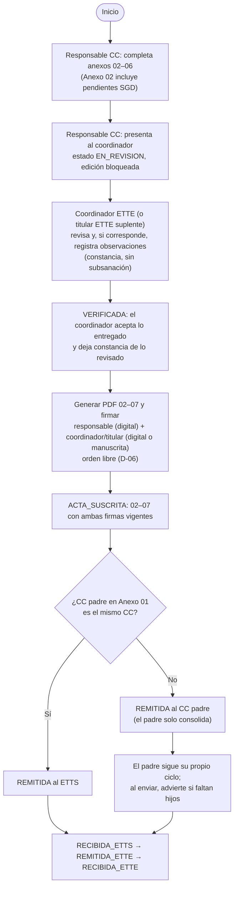

# Plan de adecuación del sistema a la Directiva N° 00X-2026-MDSJ/GM

**Fecha:** 2026-11-17
**Línea base:** [consolidado_directiva_transferencia_gestion.md](consolidado_directiva_transferencia_gestion.md) (requerimientos RF/RN/F citados por su ID).
**Código revisado:** rama `main` en `42f9b38`. Base local con el proceso 1 abierto, 206 dependencias activas y ninguna entrega registrada.

Este documento reúne el contexto, las decisiones tomadas y los cambios necesarios, ordenados por fases. Cada fase se puede desplegar sola y trae sus criterios de aceptación.

---

## 1. Decisiones de negocio

| ID | Decisión |
|---|---|
| D-01 | El **Anexo 01 se respeta tal cual**: 64 CC con código, descripción, nivel y CC padre, porque es el registrado oficialmente en CEPLAN (POI 2026). No se corrigen sus inconsistencias. |
| D-02 | **Ruteo:** cada CC envía a **su CC padre del Anexo 01**, sin considerar el nivel. Los CC cuyo padre es el mismo CC envían **directo al ETTS**. |
| D-03 | Se **eliminan los equipos de trabajo**: desaparecen el rol, el ruteo y la variante del acta firmada por el "Responsable del CC receptor". |
| D-04 | **Terminología:** el "delegado ETTE" del sistema es el **coordinador ETTE** de la directiva. Los **titulares ETTE** son el comité. Si el coordinador falta a la revisión de su CC, **firma un titular ETTE**. |
| D-05 | **Firma obligatoria de ambos lados en los anexos 02 al 07:** el responsable del CC y el coordinador ETTE (o, en su lugar, un titular ETTE). **Se elimina la constancia de ausencia ETTE.** |
| D-06 | **La firma no es secuencial.** (a) El coordinador puede firmar primero, de forma manuscrita (PDF escaneado) o digital, y el responsable firma digitalmente encima; con eso basta. (b) Si el responsable firma primero digitalmente, el coordinador **debe** firmar digitalmente, porque una firma manuscrita invalidaría la digital. Lo ideal es que ambos firmen digitalmente. |
| D-07 | **No hay ciclo de subsanación** (decisión del 2026-11-17, reemplaza la anterior): la transferencia no es una auditoría. El coordinador **acepta lo que se entrega**; si lo considera, **registra observaciones como constancia** (no exigen respuesta ni corrección y no devuelven la entrega). Después de aceptar, se firma y el flujo continúa. Las observaciones aparecen en el Acta 07 (sección IV) y en el reporte al comité ETTE. |
| D-08 | **El CC padre solo consolida:** no observa ni devuelve lo que envían sus hijos. Puede enviar aunque algún hijo no haya enviado; en ese caso el sistema muestra una advertencia y los hijos que falten envían después. |
| D-09 | **Anexo 02, sección IV (agenda pendiente):** combina la entrada libre con los **pendientes del SGD** de la dependencia. |
| D-10 | **Alta de coordinadores ETTE por dos vías:** formulario web y **plantilla Excel**. |
| D-11 | **Vinculación de datos:** una **tabla de equivalencias** relaciona cada dependencia del SGD o del SIGA con un CC del Anexo 01. Varias dependencias pueden apuntar al mismo CC. |
| D-12 | **Entran en esta etapa:** el envío ETTS → ETTE, el cálculo en días hábiles con el plazo CGR, el reemplazo de coordinador con constancia y el ajuste del Acta 07 (hora, lugar, "No aplica"). |
| D-13 | **Firma presencial del coordinador** (decisión del 2026-11-24, reemplaza la aceptación de D-07 y el portal operativo del coordinador): el coordinador ETTE revisa y **firma en la sesión del responsable del CC**, con su propio certificado. **Firmar es aprobar**: ya no hay paso «Aceptar entrega». Las observaciones las registra el responsable a nombre del coordinador. Si el coordinador falta, el responsable designa a un titular ETTE en suplencia, con motivo. Se mantiene la firma manuscrita (el responsable sube el escaneo). El coordinador conserva su cuenta solo para consultar. Ver fase 10. |

---

## 2. Situación actual (resumen de la revisión)

| Tema | Hoy | Brecha |
|---|---|---|
| Organigrama | Jerarquía del SGD con 206 nodos activos (158 del SGD y 48 del SIGA); nivel calculado por profundidad (1 al 6); incluye "ACTIVIDAD META", "CAJA CHICA", comités y nombres en `NULL`. Todo cuelga de Alcaldía `00001` ([migración](../../backend/database/migrations/2026_11_13_160000_unificar_raiz_organigrama_alcaldia.php)). | No hay código CEPLAN; los niveles no coinciden con el Anexo 01 (por ejemplo, la Oficina General de Administración tiene nivel 3 en el sistema y nivel 2 en el Anexo 01). |
| Envío | `remitirEntrega()` envía al `parent_id` del SGD; si no hay padre, el destino es `NULL` (ETTS) ([TransferenciaService.php](../../backend/app/Modules/Transferencia/Services/TransferenciaService.php)). | Un CC de nivel 2 llega al ETTS pasando por Gerencia Municipal y Alcaldía. |
| Revisión | La hace el responsable del CC padre (`revisarEntrega`: observar o consolidar), después del envío. | En la directiva revisa el coordinador ETTE, antes de firmar y antes de enviar. |
| Observaciones | Existen (enum `EstadoObservacion`, `ObservacionService`) con ciclo de subsanación; el rol `delegado_ette` **no** tiene `observaciones.registrar`. | El coordinador no puede observar; con D-07 las observaciones pasan a ser solo constancia, sin subsanación. |
| Firma | Firma Perú (PAdES) obligatoria solo del responsable del CC (`requisitosRemision`). El delegado firma de forma opcional: digital encadenada (`documento_previo_id`) o con un escaneo (`recibirManual`, estado `pendiente_validacion`). | No se puede firmar digitalmente sobre un escaneo; no se impide subir una firma manuscrita después de una digital; el titular ETTE no puede firmar (recibe 403); el acta queda "suscrita" solo con la firma del responsable. |
| Roles | `responsable_equipo`, `coordinador` y `delegado_ette` existen por separado ([Rol.php](../../backend/app/Support/Enums/Rol.php)). | Hay que quitar los equipos y unificar coordinador con delegado. |
| Pendientes del SGD | El módulo `Documentos` (`DocumentoPendiente`, con origen SGD o manual) se presenta como un "Anexo 01" con su propio PDF ([anexo01.blade.php](../../backend/resources/views/pdf/anexo01.blade.php)). | Ese nombre choca con el Anexo 01 de CC; el Anexo 02 no muestra los pendientes del SGD. |
| Delegados | Alta y asignación por web ([DelegadoService.php](../../backend/app/Modules/Auth/Services/DelegadoService.php)). | Falta la importación por Excel (el paquete de Excel ya está instalado y hoy solo se usa para exportar). |
| Cronograma | Bloquea el envío al vencer el plazo (`CronogramaService::exigirPlazoVigente`). | No calcula días hábiles ni feriados, ni la regla de 2 días hábiles antes del plazo CGR. |
| Acta 07 | Imprime el nivel del SGD; el receptor por defecto es el responsable del CC padre. | Faltan hora, lugar y "No aplica" (Anexo 06 y Otros); el receptor debe ser el coordinador o un titular ETTE. |
| ETTS → ETTE | El ETTE solo consulta. | No existen los estados recibido ETTS, enviado al ETTE ni recibido ETTE. |

---

## 3. Flujo objetivo



### 3.1 Máquina de estados de la entrega (una por CC y proceso)

| Estado | Entra cuando | Edición de anexos | Sale a |
|---|---|---|---|
| `borrador` | Inicio | Sí | `en_revision` |
| `en_revision` | El responsable presenta al coordinador | No | `verificada` |
| `verificada` | El coordinador acepta lo entregado (con o sin observaciones registradas) | No | `acta_suscrita` |
| `acta_suscrita` | Los anexos 02 al 07 tienen firma vigente de ambos lados | No | `remitida` |
| `remitida` | El responsable envía al CC padre o al ETTS | No | `recibida_etts` (solo si el destino es el ETTS) |
| `recibida_etts` | El ETTS registra la recepción | No | `remitida_ette` |
| `remitida_ette` | El ETTS envía al ETTE | No | `recibida_ette` |
| `recibida_ette` | El ETTE registra la recepción (estado final) | No | — |

Los estados `consolidada`, `cerrada` y `observada` se retiran; los datos existentes se migran (`observada` → `en_revision`). No hay vuelta atrás desde `en_revision`: el coordinador no devuelve la entrega. Las firmas solo se habilitan en `verificada`. Si los datos cambian (por ejemplo, por una reingesta del SGD), la huella del documento invalida las firmas (mecanismo actual de `DocumentoFirma`) y hay que volver a generar y firmar.

Complemento hasta la fecha de cese (RF-26 y RF-68, F-17): **fuera del alcance de esta etapa**. Queda anotado como pendiente.

---

## 4. Modelo de datos (cambios)

**Estrategia para D-11:** los 64 CC se cargan **como filas de `dependencias`** con origen `ceplan`, y las dependencias del SGD y del SIGA se vinculan a ellos. Así se conservan todas las claves foráneas `dependencia_id` (anexos, firmas, entregas, asignaciones) y los cálculos de ámbito (`idsSubarbol`) pasan a recorrer el árbol del Anexo 01.

| Cambio | Detalle |
|---|---|
| `dependencias` | Nuevas columnas: `codigo_ceplan` (único por proceso), `nivel_ceplan` (1/2/3, solo informativo, para PDF y acta), `es_centro_costo` (bool), `envia_a_etts` (bool, verdadero cuando el padre es el mismo CC). Para los CC, `parent_id` = CC padre del Anexo 01, o `NULL` si el padre es el mismo CC. |
| `equivalencias_centro_costo` (nueva) | `dependencia_origen_id` (dependencia del SGD o del SIGA) → `centro_costo_id`; además `origen` (sgd/siga), `confirmada_por_id` y `confirmada_en`. Cada dependencia de origen tiene una sola equivalencia. |
| Dependencias del SGD y del SIGA | Siguen en la tabla para trazabilidad e ingesta, pero quedan fuera del flujo (`es_centro_costo = false`). El selector, el organigrama, el tablero y el envío solo muestran CC. |
| `entregas` | Nuevo conjunto de estados (ver 3.1); `destino` = `dependencia_destino_id` (CC padre) o `NULL` (ETTS); fechas `presentada_en`, `verificada_en`, `verificada_por_id` (con la calidad ETTE, el motivo de suplencia y el texto de lo revisado), `recibida_etts_en`, `remitida_ette_en`, `recibida_ette_en` (con usuario en cada caso); `hijos_pendientes_al_remitir` (json, para la advertencia de D-08). |
| `asignaciones_rol` | Se elimina `responsable_equipo` y se unifica `coordinador` en `delegado_ette`; la etiqueta pasa a ser **"Coordinador ETTE"** (el valor interno se puede mantener para no romper datos). Nuevas columnas: `acreditada_en`, `acreditada_por_id`, `reemplaza_a_id`, `motivo_reemplazo`. |
| `firmas_anexo` / `firma_sesiones` | Nuevo campo `lado` (`entidad` o `ette`) y `en_calidad_de` (`coordinador` o `titular_suplente`), con `motivo_suplencia` cuando firma un titular. La sesión manual pasa a contar como firma válida del lado ETTE (ver fase 4). |
| `observaciones` | Nuevos campos `dependencia_id` (CC) y `anexo`; pueden referirse a una fila o al **anexo completo** (sin observable), para documentos sin filas como el Anexo 02. Son constancia: sin subsanación ni ronda (D-07). |
| `feriados` (nueva) | `fecha`, `descripcion`, `alcance` (nacional/local). |
| `cronograma_actividades` | Nuevos campos `fecha_cgr` y `dias_habiles_antes` (por defecto 2). El vencimiento interno se calcula a partir de ellos. |
| `actas_transferencia` | Nuevos campos `lugar`, `hora`; `anexos_entregados` pasa a guardar `entregado`, `no_entregado` o `no_aplica` (este último solo para 06 y Otros); `otros_documentos` (texto). |
| `informes_gestion` | Nuevas columnas `pendientes_documentales` (json) y `pendientes_congelados_en`: los documentos pendientes del CC se leen en vivo hasta presentar y luego se usa la copia congelada; en ambos casos entran en la huella (fase 5). |

---

## 5. Fases

### Fase 0 — Preparación

1. Crear una rama `feature/directiva-2026`.
2. Instalar Laravel Boost (`composer require laravel/boost --dev && php artisan boost:install`), como pide `CLAUDE.md`/`AGENTS.md`, y leer las guías que genere.
3. Ejecutar la suite actual (`backend/tests/Feature`, unos 40 tests) y registrar la línea base.
4. Respaldar la base antes de cada migración de datos (ya existe `respaldo-antes-asignaciones.dump`; generar uno nuevo).

**Resultado (2026-11-17):**
- Rama `feature/directiva-2026` creada desde `d606638`.
- Laravel Boost v2.10.4 ya estaba instalado; se agregó Claude Code a `boost.json` y se regeneraron las guías y skills (`backend/AGENTS.md`, `backend/.claude/skills`, `backend/.agents/skills`). El `CLAUDE.md` y el `AGENTS.md` de la raíz apuntan ahora a esas guías y describen cómo ejecutar artisan en Docker.
- Línea base de pruebas: **275 pasan (1254 aserciones), 0 fallan**, en 20,6 s (`docker exec sis_transferencia_backend php artisan test`, SQLite en memoria).
- Respaldo de la base: `/home/siracom/sis-transferencia-respaldos/respaldo-fase0-2026-11-17.dump` (`pg_dump -Fc`, 37 tablas con datos), **fuera del repositorio**.
- Se corrigieron los permisos `600` de varios archivos de código (backend y frontend) que el contenedor no podía leer.

### Fase 1 — Catálogo del Anexo 01, equivalencias y envío (D-01, D-02, D-03, D-11)

Es la base de todas las demás fases.

**Backend**
- Seeder `CentrosCostoAnexo01Seeder` con los 64 CC del Anexo A del consolidado (código, descripción, nivel, padre). Los que tienen el padre igual a sí mismos (`01`, `02`, `03`, `04`, `05`, `06`, `07`…`17`) quedan con `parent_id = NULL` y `envia_a_etts = true`.
- Seeder `EquivalenciasCentroCostoSeeder` con una propuesta inicial: (1) por `codigo_siga`; (2) por nombre normalizado (sin tildes, mayúsculas, "OFICINA DE" ≈ "UNIDAD DE"); (3) los nodos de metas, cajas chicas y comités se asignan a su ancestro del SGD que ya tenga equivalencia. Todo lo que no se resuelva queda **sin asignar** para que el administrador lo revise.
- Endpoints de administración: `GET/PUT /api/centros-costo/equivalencias` (permiso `parametros.gestionar`) y un listado de dependencias sin asignar.
- Ingestas (`IngestaSgd`, `IngestaPatrimonioSiga`, `IngestaPersonalSgd`, `IngestaDocumentalSgd`, `AcervoSgdService`): al grabar, convertir `dependencia_origen → centro_costo` y guardar el `dependencia_id` del **CC**. Conservar la dependencia de origen en `fuente_referencia` para trazabilidad.
- `TransferenciaService::remitirEntrega()`: destino = `parent_id` del CC (que ya es el padre del Anexo 01) o `NULL` (ETTS) cuando `envia_a_etts` es verdadero.
- Responsable del CC: el encargado del SGD de la dependencia principal vinculada, con posibilidad de corregirlo a mano (RF-06).
- Retirar `Rol::RESPONSABLE_EQUIPO` y sus permisos; migrar sus asignaciones a `responsable_centro_costo` o revocarlas tras revisarlas con el usuario.

**Frontend**
- `EstructuraOrganicaPage` y `DependenciaSelector`: mostrar el árbol del Anexo 01 (código CEPLAN y nivel).
- Pantalla de administración de equivalencias: dependencia del SGD/SIGA → CC, con filtro "sin asignar".
- Quitar todas las referencias a "equipo de trabajo" (`AppLayout`, `InformeGestionPage`, `DespachoPersonalView`, `auth/permisos.ts`).

**Migración de datos:** reasignar al CC equivalente los registros de anexos que hoy apuntan a dependencias del SGD o del SIGA. Hoy no hay entregas, así que el riesgo es bajo.

**Implementación (2026-11-17)** — ajustes respecto de lo planeado:
- **Equivalencias a mano, por nombre** (decisión del usuario): no hay código común entre SGD/SIGA y el Anexo 01. Ya no hay reglas automáticas (ni `codigo_siga`, ni ancestros). La propuesta inicial está en `backend/database/data/equivalencias_centro_costo.csv` (SGD 68/158 y SIGA 101/107 asignadas por nombre); el resto queda **sin asignar** para la pantalla *Administración → Centros de costo (Anexo 01)*. El SIGA se vincula por su propio código de CC (`origen = siga`), sin pasar por el SGD.
- `nivel_ceplan` y `envia_a_etts` no se crearon: en los CC, `nivel` guarda el nivel CEPLAN y "envía al ETTS" se deriva de `parent_id = NULL` (`Dependencia::enviaAEtts()`). La unicidad de `codigo` pasó a ser por tipo de fila, porque el código "01" existe en el SGD y en el Anexo 01.
- La equivalencia marca una dependencia **principal** por CC, de la que sale el encargado (responsable) del CC.
- Despliegue: `migrate` → `db:seed --class=CentrosCostoAnexo01Seeder` → `db:seed --class=EquivalenciasCentroCostoSeeder` → revisar equivalencias → `centros-costo:reasignar --simular` → `centros-costo:reasignar`.
- **Vinculación completada (2026-11-17):** se asignaron por nombre 85 unidades más (SGD 149/158, SIGA 105/107). Metas, cajas chicas y unidades internas van al CC de la oficina a la que pertenecen; Mesa de Partes → 06.01; Secretaría Técnica CODISEC → 16.04; Relaciones Públicas (SIGA) → 03.01; Áreas Verdes → 17.01; Junta de Delegados Vecinales y Asistencia Alimentaria → 15.02. **Siguen sin asignar a propósito:** los comités y comisiones temporales (00117, 00124, 00132, 00133, 00146), el Programa de Incentivos (00135), las unidades sin nombre o inhabilitadas (00069, 00096, 00136), el Consejo de Coordinación Local (SIGA 01.01.03) y la Municipalidad (SIGA 01). En total son ~95 registros, y ninguno de ellos es un bien.
- Ejecutado en local: respaldo `respaldo-antes-reasignacion-2026-11-17.dump` → `centros-costo:reasignar` (6302 bienes, 6984 pendientes, 643 de personal y 1110 filas de acervo, de las que 300 se fusionaron) → reingesta `sgd:ingestar --catalogos --documental` y `siga:ingestar`. Resultado: 6182 pendientes, 643 de personal, 810 filas de acervo y 6302 bienes, todos en CC. 62/64 CC tienen responsable; 02 y 14.02.01 no tienen dependencia en el SGD.

**Criterios de aceptación**
- Hay exactamente 64 CC activos; el selector solo los muestra.
- 07.05 envía a 07; 07 envía al ETTS; 03.01 envía a 03; 06 envía al ETTS; 06.01 envía a 06; 11.02.01 envía a 11.02; 15.01 envía a 15 (F-14).
- Los bienes del SIGA de "UNIDAD DE CONTROL PATRIMONIAL" y "OFICINA DE GESTIÓN PATRIMONIAL" aparecen en el CC 11.05.
- Tests nuevos: `RuteoAnexo01Test` y `EquivalenciasCentroCostoTest`; adaptar `FlujoRemisionTest`, `CierreHaciaEttsTest`, `OrganigramaNavegacionTest` y `AutorizacionAmbitoTest`.

### Fase 2 — Coordinadores ETTE: roles, alta por web y Excel, reemplazo (D-04, D-10, D-12)

**Roles y permisos** ([Permiso.php](../../backend/app/Support/Enums/Permiso.php))
- `delegado_ette` pasa a llamarse **Coordinador ETTE** y se le agregan `observaciones.registrar` y un nuevo permiso `entregas.verificar`, ambos limitados a los CC asignados.
- Se elimina `Rol::COORDINADOR` y sus asignaciones se migran a `delegado_ette`.
- `Rol::ETTE` (titular): se le agregan `firmas.firmar` (solo como suplente), `observaciones.registrar` y `entregas.verificar` como suplente, y `entregas.recibir_ette`. La suplencia exige indicar el motivo (ausencia del coordinador) y queda auditada.
- `Rol::ETTS`: `entregas.recibir_etts` y `entregas.remitir_ette`.
- Se quitan `entregas.revisar` y `entregas.consolidar` del responsable del CC (D-08).

**Alta por web:** se mantiene [DelegadosPage.tsx](../../frontend/src/features/delegados/DelegadosPage.tsx). El selector de dependencia pasa a ser de CC (código CEPLAN).

**Alta por Excel**
- `GET /api/delegados/plantilla`: descarga una plantilla `.xlsx` con las columnas `DNI`, `Apellidos`, `Nombres`, `Correo`, `Celular`, `Código CC (Anexo 01)` y `Observación`, y una hoja de consulta con los 64 CC.
- `POST /api/delegados/importar?modo=previsualizar` devuelve el resultado fila por fila (`crear_usuario`, `asignar`, `ya_asignado` o `error`, con el motivo). `modo=confirmar` aplica todo en una sola transacción.
- Validaciones: DNI de 8 dígitos; el CC existe y está activo; no hay filas repetidas (DNI + CC) en el archivo; un DNI que existe en el padrón usa su cuenta y uno que no existe crea un usuario externo (se reutiliza `DelegadoService::crearExterno`); se avisa si el CC ya tiene coordinador.
- Clases nuevas: `App\Modules\Auth\Excel\DelegadosImport`, `DelegadosPlantillaExport` y `ImportacionDelegadosService`. En el frontend, un modal de carga con la tabla de previsualización.

**Reemplazo de coordinador (RF-15, RN-12, F-12)**
- `POST /api/delegados/{id}/reemplazar` recibe el nuevo coordinador y el motivo. Revoca la asignación anterior, crea la nueva con `reemplaza_a_id` y genera una **constancia PDF**. Las firmas y observaciones del coordinador anterior se conservan; los plazos no se modifican.
- Notificación dentro del sistema al responsable del CC (bandeja o aviso en el inicio). Por correo, solo si ya existe un canal configurado.
- `GET /api/delegados/relacion/pdf`: relación de coordinadores acreditados (RF-13).

**Criterios de aceptación:** se importa una plantilla con 10 filas válidas y 2 erróneas, la previsualización muestra las 2 con su motivo y solo se aplican las válidas; un reemplazo deja constancia y no cambia ninguna fecha del cronograma. Tests: `ImportacionDelegadosTest`, `ReemplazoCoordinadorTest`; adaptar `DelegadoGestionTest` y `DelegadoEtteAmbitoTest`.

**Implementación (2026-11-17)** — ajustes respecto de lo planeado:
- Migración `2026_11_17_193822_coordinadores_ette_acreditacion_y_reemplazo`: `coordinador` → `delegado_ette`; en `asignaciones_rol`, `acreditada_en/por`, `observacion`, `reemplaza_a_id`, `motivo_reemplazo` y además `revocada_en/por`. **Revocar ya no borra**: la asignación queda revocada (historial y constancia) y un scope global de `AsignacionRol` la excluye de todo permiso y ámbito. La unicidad pasa a un índice parcial solo sobre asignaciones vigentes. `users.celular` nuevo. `observaciones.en_calidad_de` y `motivo_suplencia`.
- Permisos nuevos: `entregas.verificar`, `entregas.recibir_etts`, `entregas.remitir_ette`, `entregas.recibir_ette` (los endpoints que los usan llegan en F3 y F6).
- Suplencia del titular: servicio `CoordinacionEtte` + enum `CalidadEtte`. Ya se aplica a las observaciones: un titular ETTE que no es coordinador del CC debe indicar `motivo_suplencia` (422 si falta). F3 y F4 lo reutilizan para verificar y firmar. Hasta F4, la firma del titular sigue rechazada (403) por `FirmaperuRegistroService::caracter()`.
- **Diferido a F3:** quitar `entregas.revisar` y `entregas.consolidar` del responsable del CC. Quitarlos ahora rompería la consolidación actual antes de que exista la verificación del coordinador.
- Excel: las cuentas nuevas reciben una **contraseña temporal** que se muestra una sola vez al confirmar (no hay columna de contraseña en la plantilla). Un DNI del **padrón del SGD sin cuenta** se rechaza en la fila: su cuenta se activa desde el padrón para que reciba sus roles de servidor. DNI y código CC van como texto en la plantilla; un DNI leído como número recupera el cero inicial y un código CC numérico se rechaza.
- El alta externa por web exige ahora DNI de 8 dígitos (antes 8–15), porque el coordinador debe poder firmar con Firma Perú.
- Reemplazo: `POST /api/delegados/{id}/reemplazar` acepta una cuenta existente (`user_id`) o una externa nueva (`nuevo`). La constancia se genera al vuelo (`GET /api/delegados/{id}/constancia-reemplazo/pdf`). Historial en `GET /api/delegados/historial`.
- Aviso al responsable: `GET /api/coordinadores-ette/mis-centros` (coordinadores vigentes y reemplazos de los últimos 30 días), que se muestra en el inicio.
- Ejecutado en local: respaldo `respaldo-antes-fase2-2026-11-17.dump` → `migrate` → `db:seed --class=RolesPermisosSeeder`. Suite: **317 pasan**.

### Fase 3 — Aceptación del coordinador y observaciones como constancia (D-07, D-08)

**Criterio (D-07):** la transferencia no es una auditoría. El coordinador ETTE no devuelve la entrega ni pide correcciones: **acepta lo entregado** y, si lo considera, deja **observaciones como constancia**. Luego se firma y el flujo sigue.

**Backend**
- Endpoints en `TransferenciaController`:
  - `POST /api/transferencia/presentar` (responsable, permiso `entregas.remitir`): de `borrador` a `en_revision`. Bloquea la edición de los anexos.
  - `POST /api/transferencia/verificar` (coordinador asignado o titular ETTE suplente con motivo, permiso `entregas.verificar`): de `en_revision` a `verificada`. Registra la constancia de aceptación (RF-54): quién, cuándo, en qué calidad y el texto de lo que se revisó y lo que no (RF-56, obligatorio).
  - **No hay** `reabrir` ni vuelta a `borrador`.
- Observaciones (`POST /api/observaciones`): solo el lado ETTE del CC (coordinador o titular suplente con motivo; el responsable del CC padre recibe 403, D-08). Se admiten mientras la entrega está `en_revision` (antes de aceptar); sobre una fila o sobre el anexo completo. **No cambian el estado de la entrega**, no se subsanan y no tienen ronda. El coordinador puede retirar (desestimar) una observación propia antes de aceptar.
- Se retiran: `revisarEntrega` (observar o consolidar del CC padre), el `VistoBuenoDelegado` (controller, modelo, rutas, permiso `delegado.visto_bueno`; la tabla queda como historial), los permisos `entregas.revisar` y `entregas.consolidar`, y `observaciones.registrar` del responsable del CC.
- `remitirEntrega()`: exige `verificada` (en F4, `acta_suscrita`) además de las firmas.
- `RespetaEstadoEntrega`: solo se edita en `borrador`.
- RF-55: `GET /api/reportes/verificacion` para el comité ETTE, con el resultado por CC (anexos faltantes, bienes sin conformidad, observaciones registradas y constancia de aceptación).

**Frontend**
- Portal del coordinador (`AnexosEntidadPage`, perfil coordinador): filtro de CC `en_revision`, registro de observaciones por anexo o por fila, y botón **"Aceptar entrega"** con el texto de lo revisado. Se retiran `VistoBuenoDelegadoBar` y el dictamen del CC padre (`RevisarModal`).
- Portal del responsable: botón **"Presentar al coordinador"** y, en solo lectura, las observaciones que dejó el coordinador.
- Retirar `BandejaRevisorView` y el flujo de subsanación de la interfaz.

**Criterios de aceptación:** F-03 (el coordinador registra observaciones y quedan como constancia), F-05 (el coordinador acepta y se habilita la firma), F-06 (no se firma ni se remite sin aceptación). F-04 (subsanar y volver a presentar) **no aplica** por D-07. El responsable del CC padre no puede observar a sus hijos (403). Tests: `RevisionCoordinadorTest`; adaptar `ObservacionesTest` y `BloqueoEdicionTrasRemitirTest`; eliminar `VistoBuenoDelegadoTest`.

**Implementación (2026-11-17)** — ajustes respecto de lo planeado:
- Migración `2026_11_17_195843_revision_coordinador_ette`: en `entregas`, `presentada_en/por`, `verificada_en/por`, `verificada_en_calidad_de`, `motivo_suplencia_verificacion` y `resultado_verificacion`; se elimina `version_acta_correccion`. Datos: `consolidada`, `cerrada` y el antiguo `en_revision` pasan a `remitida`; `observada` pasa a `en_revision`. En `observaciones`, `dependencia_id` y `anexo` (rellenados desde la fila observada), y `observable_*` pasa a ser opcional (anexo completo). Los estados de la observación se reducen a `registrada` y `retirada`, y la respuesta de subsanación queda como historial. Se elimina `actas_transferencia.declara` y el enum `DeclaracionActa`; el PDF del acta conserva el mismo texto, así que no cambia su huella.
- `RevisionEntregaService` (presentar, verificar = aceptar) y `ObservacionService` (registrar, retirar). Las observaciones solo se admiten en `en_revision` y no cambian el estado. Ya no existen `reabrir`, `subsanar`, el permiso `observaciones.subsanar`, `asegurarVersionCorreccion` ni `versionarActaPorCorreccion`. Retirar una observación solo exige actuar por el lado ETTE (sin volver a pedir el motivo de suplencia).
- Se retiraron también: `revisarEntrega` y el permiso `entregas.revisar/consolidar`, el visto bueno del delegado (controller, modelo, rutas, permiso y test; la tabla queda como historial), `observaciones.registrar` del responsable, y la "observación" automática que creaba la verificación de un bien (la nota ya vive en `VerificacionBien`). `RolesPermisosSeeder` borra del catálogo los permisos retirados.
- Reportes: `verificacion` (RF-55) con su Excel y PDF; los reportes de observaciones y la matriz dejan de usar subsanación y estados retirados. El tablero cuenta `borrador`, `en_revision`, `verificadas` y `remitidas`; el avance es el porcentaje de remitidas.
- La reingesta de personal deja fijo todo CC cuya entrega no esté en `borrador`.
- Frontend: `EntregaCentroCostoCard` (responsable: presentar, constancia de aceptación y remitir), `AceptarEntregaDialog` y `RegistrarObservacionDialog` (coordinador, desde la carpeta del CC en "Anexos de la entidad", con el filtro "Por revisar"), panel de observaciones por anexo como constancia, `ObservacionesPage` de consulta, pestaña "Verificación por CC" en Reportes y tableros con los estados nuevos. Se eliminaron `BandejaRevisorView`, `PanelAnexosDependencia`, `HojaAnexo`, `RevisarModal`, `VistoBuenoDelegadoBar`, `SubsanarObservacionModal` y `RegistrarObservacionModal`. Desde la interfaz se observa el anexo completo (antes se anclaba a la primera fila); la API sigue admitiendo una fila concreta.
- Tests: `RevisionCoordinadorTest` (nuevo) y `ObservacionesTest` reescrito; adaptados `FlujoRemisionTest`, `CierreHaciaEttsTest`, `BloqueoEdicionTrasRemitirTest`, `CronogramaBloqueoTest`, `FirmaperuFlujoInstitucionalTest`, `FlujoDocumentosFirmadosTest`, `RuteoAnexo01Test` y otros; eliminados `VistoBuenoDelegadoTest` y `ActaVersionReFirmaTest`. Helper `Tests\Concerns\PreparaEntregas`. Suite: **316 pasan**.
- Pendiente de ejecutar en local: respaldo `respaldo-antes-fase3-2026-11-17.dump` (hecho) → `migrate` → `db:seed --class=RolesPermisosSeeder`.

### Fase 4 — Firma con ambos lados obligatorios y sin orden (D-04, D-05, D-06)

**Reglas**
1. Cada documento 02–07 necesita **una firma vigente del lado entidad** (responsable del CC, siempre digital con Firma Perú) y **una firma vigente del lado ETTE** (coordinador asignado o titular ETTE suplente, digital o manuscrita según la regla 3).
2. Solo se firma en estado `verificada`.
3. **Orden libre, con estas restricciones** (D-06):
   - *ETTE primero, manuscrita:* el coordinador descarga el PDF generado, lo firma a mano y sube el escaneo. El escaneo queda como **documento base**, y el responsable firma digitalmente sobre ese escaneo. La cadena se reconoce porque la sesión del responsable apunta al escaneo (`documento_previo_id`) y este, a su vez, al PDF generado vigente (se registra su huella al subirlo). No se verifica criptográficamente el escaneo: la firma digital del responsable encima lo convalida (decisión del usuario).
   - *ETTE primero, digital:* el responsable firma sobre el PDF ya firmado (cadena actual).
   - *Entidad primero (digital):* el lado ETTE **solo puede firmar digitalmente** sobre ese PDF. Se **rechaza la subida manuscrita** (409: "Ya existe una firma digital; la firma del coordinador debe ser digital para no invalidarla").
   - Ambas firmas deben pertenecer a **la misma cadena** (un único PDF final con las dos). Dos cadenas paralelas no cumplen el requisito.
4. Se elimina la **constancia de ausencia ETTE** (`ConstanciaAusenciaController`, `firmas.constancia_ausencia`, `EstadoFirma::AUSENTE`, `ConstanciaAusenciaEtte.tsx`). Sus registros históricos se conservan como lectura.
5. Pasa a `acta_suscrita` cuando los seis documentos cumplen las reglas 1 y 3. El estado del acta (`suscrita`) exige las dos firmas.

**Cambios en el código**
- `FirmaperuRegistroService::caracter()` → reemplazar el carácter opcional/obligatorio por el `lado` (entidad o ETTE). El lado ETTE se admite para el coordinador asignado a ese CC o para un titular ETTE (con motivo de suplencia). Ya no hay firma opcional.
- `FirmaperuRegistroService::requisitosRemision()` → comprueba los dos lados en la misma cadena vigente y devuelve lo pendiente por documento y por lado.
- `FirmaperuSesionService::recibirManual()` → (a) rechazar si ya existe una firma digital vigente en la cadena; (b) dejar la sesión como `firmada` con origen `manual` (base de la cadena), sin verificación criptográfica; (c) se mantiene su huella SHA-256.
- `FirmaperuSesionService::preparar()` y `FirmaperuRegistroService::provieneDelGenerado()` → aceptar como eslabón válido una sesión manual cuyo `original_sha256` coincida con el PDF generado vigente.
- `CaracterFirma` se retira o se reemplaza por un enum `LadoFirma`. Hay que actualizar `versionarActaPorCorreccion` para que también anule las firmas del lado ETTE.
- Frontend: `PdfFirmaPage`, `BotonFirmaPeru` y `MiniEstadoFirma` muestran dos casillas por documento (Entidad / ETTE), indican quién firmó y en qué calidad, y ocultan "Subir firma manuscrita" cuando ya hay una firma digital.

**Criterios de aceptación:** las 4 combinaciones de orden (ETTE manuscrita → entidad, ETTE digital → entidad, entidad → ETTE digital, entidad → intento de ETTE manuscrita, que se rechaza); la firma de un titular suplente con motivo; no se puede enviar con un solo lado firmado; si se edita un dato después de firmar, se invalidan ambas firmas. Tests: adaptar `FirmaperuSubirManualTest`, `FirmaperuFlujoInstitucionalTest`, `GateFirmaActaRemisionTest` y `FirmaAnexoTest`; eliminar `ConstanciaAusenciaEtteTest`.

**Implementación (2026-11-17)** — ajustes respecto de lo planeado:
- Migración `2026_11_17_204119_firma_ambos_lados_directiva`: en `firma_sesiones` y `firmas_anexo`, `caracter` se reemplaza por `lado` (`entidad`/`ette`), `en_calidad_de` y `motivo_suplencia` (obligatoria → entidad; opcional → ette como coordinador). Las constancias de ausencia (`estado = ausente`) se archivan con borrado lógico. Se elimina `procesos_transferencia.exige_firma_acta`: la firma de ambos lados es siempre obligatoria. Nuevo estado de entrega `acta_suscrita` (sin cambio de columna).
- La firma se separó por responsabilidades: `FirmantesDocumento` (quién firma y por qué lado, enum `LadoFirma`), `CadenaFirmas` (vigencia y cadena de PDF: el documento queda suscrito cuando **una misma cadena** reúne ambos lados), `SuscripcionEntrega` (requisitos para remitir por documento y por lado, acta `suscrita` y estado `acta_suscrita`), `FirmaperuRegistroService` (versiones y registro del hecho de firma), `FirmaperuSesionService` (firma digital) y `FirmaManuscritaService` (escaneo del lado ETTE).
- **Encadenado automático:** al preparar una firma sin `documento_previo_id`, el backend la agrega sobre la cadena vigente del documento; así ambas firmas quedan en un único PDF sin que la interfaz tenga que elegir el PDF previo.
- El lado entidad es **solo el responsable del CC** (el servidor, el ETTS y el responsable de un CC padre ya no firman; sí pueden generar los PDF). La firma ETTE de un coordinador reemplazado se conserva (RN-12); la del responsable exige que lo siga siendo.
- La firma manuscrita queda `firmada` (origen `manual`) como base de la cadena; se rechaza (409) si ya hay una firma digital vigente, si la sube el responsable (403) o si falta el motivo del titular suplente (422). `firmaperu:validar-pendientes` ignora las sesiones manuales.
- Solo se firma en `verificada` o `acta_suscrita` (409 en otro estado). `remitirEntrega()` exige uno de esos estados y los seis documentos con ambos lados; el mensaje detalla el lado que falta por anexo. El tablero cuenta `acta_suscrita` como subtotal de `verificadas`.
- `GET /firmaperu/estado/...` devuelve `completo`, `entidad`, `ette` (firmante, calidad, origen), `hay_firma_digital`, `mi_lado` y `firma_habilitada`; `requisitos-remision` agrega `documentos` por lado.
- Se retiraron la constancia de ausencia (controller, servicio, ruta, permiso `firmas.constancia_ausencia`, `EstadoFirma::AUSENTE`, componente y test), `CaracterFirma`, los scopes `obligatorias`/`ausentesEtte`, los campos de copia digital del modelo y la opción "Agregar firma de otro firmante".
- Frontend: casillas Responsable / Coordinador ETTE en `DocumentoFirmaDetalle`, `MiniEstadoFirma` con el lado que falta, `BotonFirmaPeru` según `mi_lado` (pide el motivo al titular suplente con `MotivoSuplenciaDialog`), `FirmaManuscritaEtte` (reemplaza `FirmaManualDelegado` y `delegado.service`, se oculta si ya hay firma digital), paso "Acta suscrita" en `EntregaCentroCostoCard` y helper `estaEnFirma()` en tableros y reportes.
- Tests: `FirmaAmbosLadosTest` (nuevo: las 4 combinaciones, titular suplente, firma antes de aceptar, CC ajeno, invalidación de ambas firmas); adaptados `FirmaperuFlujoInstitucionalTest`, `FlujoDocumentosFirmadosTest`, `FirmaperuSesionTest`, `FirmaperuBorradorTest`, `FirmaAnexoTest` y los mocks de remisión; eliminados `FirmaperuSubirManualTest` (absorbido), `GateFirmaActaRemisionTest` y `ConstanciaAusenciaEtteTest`. Suite: **310 pasan**.
- Pendiente de ejecutar en local (junto con lo pendiente de F3): respaldo → `migrate` → `db:seed --class=RolesPermisosSeeder` (retira `firmas.constancia_ausencia`).

### Fase 5 — Anexo 02 con pendientes del SGD (D-09)

- `GestionService::datos()`: la sección IV combina `pendientes_items` (entrada manual) con los `DocumentoPendiente` del CC (origen SGD, todas las dependencias de origen vinculadas). Correspondencia de columnas: *Asunto* ← asunto o sumilla; *Estado y acción requerida* ← estado del SGD y justificación; *Documento o expediente* ← número de documento o expediente; *Plazo* ← fecha límite, si existe; *Unidad competente* ← dependencia de destino. Cada fila indica su origen (SGD o manual).
- La huella del Anexo 02 (`FirmaperuPdfService::huella`) incluye los pendientes del SGD, de modo que un cambio en el SGD exige generar de nuevo el PDF y volver a firmar. Para que el documento no cambie durante la revisión, los pendientes se **congelan** al presentar (`en_revision`) en una copia fija dentro de `informes_gestion`. Antes de presentar, se pueden actualizar con un botón "Actualizar pendientes del SGD".
- Se retira el "Anexo 01 – Documentos pendientes" como anexo independiente: se quita del menú, de `presenciaAnexos()` (`anexo_01`), del paquete PDF y de `anexo01.blade.php`. La pantalla `DocumentosPage` puede quedar como "Pendientes SGD" (consulta y detalle) enlazada desde el Anexo 02.
- Criterios: el PDF del Anexo 02 muestra los pendientes del SGD y los manuales; si cambia un pendiente del SGD antes de presentar, el PDF se actualiza; después de presentar, queda fijo. Tests: `InformeGestionPdfTest` y `DocumentoPendienteSumillaTest`.

**Implementación (2026-11-17)** — ajustes respecto de lo planeado:
- **El "Anexo 01 – Documentos pendientes" ya no existía como PDF:** `anexo01.blade.php` es, desde antes de esta fase, la relación de CC del Anexo 01 (`CentrosCostoPdf`), y ni el paquete ni el expediente incluían los pendientes. Solo quedaban restos: `presenciaAnexos()['anexo_01']` (calculado con `DocumentoPendiente` e ignorado por el acta), `anexo_01` en `types/acta.ts` y los textos "Anexo 01" del módulo `Documentos` (servicio, controlador y avisos). Se retiraron. El menú pasa a decir "Documentos pendientes" y la pantalla indica que sus registros entran a la sección IV del Anexo 02.
- **Sin botón "Actualizar pendientes del SGD"** (decisión del usuario): antes de presentar, el Anexo 02 lee en vivo lo último ingerido; la ingesta sigue siendo administrativa (`sgd:ingestar --documental`).
- **Los `DocumentoPendiente` manuales se mantienen** (decisión del usuario): el alta manual de la pantalla de documentos sigue disponible y esos registros entran a la sección IV junto con los del SGD. Orden de la sección IV: primero la entrada libre del informe (`pendientes_items`) y luego los documentos pendientes (por fecha del documento; los que no tienen fecha, al final). La numeración es correlativa y una columna nueva, "Origen", indica SGD o Manual.
- Correspondencia de columnas: *Asunto* ← la sumilla si se registró; si no, el asunto. *Estado y acción* ← la descripción del estado de recepción del SGD (catálogo `estados_sgd`), la justificación y la acción pendiente. *Documento* ← tipo y número. *Plazo o fecha* ← "Doc. del dd/mm/aaaa", porque el SGD no tiene fecha límite. *Unidad* ← el CC y, si se conoce, el servidor de destino; la ingesta no guarda la dependencia del SGD de destino, solo el CC.
- Clases nuevas en `App\Modules\Gestion\Services`: `PendientesDocumentales` (lee los documentos del CC y los convierte en filas), `AgendaPendiente` (arma la sección IV a partir de la copia congelada o de la lectura en vivo) y `CongelamientoAgendaPendiente` (guarda la copia). `RevisionEntregaService::presentar()` congela dentro de la misma transacción y, si el CC aún no tiene informe, crea la fila solo con la copia. Para que esa fila no cuente como "Anexo 02 entregado", `anexo02_gestion.existe` exige ahora que el informe tenga funciones (guardarlo exige al menos una).
- Migración `2026_11_17_220000_agenda_pendiente_anexo02`: `informes_gestion.pendientes_documentales` (json) y `pendientes_congelados_en`. No hay entregas presentadas en la base local, así que no hace falta congelar datos existentes. La huella del Anexo 02 no necesitó cambios: se calcula con la vista renderizada, que ya incluye los pendientes.
- API: `GET /api/gestion/informe` devuelve `agenda_documental` (copia congelada o lectura en vivo) y `pendientes_congelados_en`; la columna json va oculta. Frontend: `PendientesDocumentalesTabla` (solo lectura, con enlace a "Documentos pendientes" e indicación de copia congelada) bajo la sección IV de `InformeGestionPage`. Presentar invalida la consulta del informe.
- **Firma del Anexo 01 (relación de CC):** el usuario decidió que la firman **el ETTS y el ETTE al final de todo** (firma institucional, no por CC). Se pasa a la fase 6, junto con la cadena ETTS → ETTE. Por ahora el `anexo01` sigue en `FirmaperuController::TIPOS` (solo vista previa) y `FirmantesDocumento` no deja firmarlo a nadie.
- Tests: `InformeGestionPdfTest` (la sección IV combina entrada libre, SGD y manuales; la huella cambia antes de presentar y queda fija después; la fila congelada no cuenta como informe) y `DocumentoPendienteSumillaTest` (la sumilla y la justificación pasan a la sección IV). Suite: **313 pasan**.
- Pendiente de ejecutar en local (junto con lo pendiente de F3 y F4): respaldo → `migrate`.

### Fase 6 — Consolidación del CC padre y cadena ETTS → ETTE (D-08, D-12)

- **Consolidación:** la vista "Consolidado" del CC padre (ya existe en `AnexosEntidadPage`) muestra sus anexos y los de su subárbol, con el **autor y el CC de origen** de cada elemento (RF-43). El padre no cambia los datos de sus hijos.
- **Advertencia al enviar:** `remitirEntrega()` calcula los hijos directos que aún no han enviado. Si hay alguno, la respuesta exige `confirmar_sin_hijos=true` y guarda la lista en `hijos_pendientes_al_remitir`. Un hijo puede enviar después aunque su padre ya haya enviado; en ese caso el tablero lo marca como "enviado tarde".
- **ETTS:** bandeja con los CC enviados al ETTS (`envia_a_etts`), acción "Registrar recepción" (`recibida_etts`) y acción "Enviar al ETTE" (por CC o en lote) que genera una constancia de entrega (RF-75).
- **ETTE:** bandeja de recepción con la acción "Registrar recepción" (`recibida_ette`), que cierra el flujo.
- Expediente (`ExpedientePdf`): incluir el Acta 07 firmada y los PDF firmados finales, no solo los borradores.
- **Anexo 01 (relación de CC) firmado por el ETTS y el ETTE al final de todo** (decisión del usuario, 2026-11-17): es una firma institucional del proceso, no de cada CC. Hay que definir con qué datos se genera (el catálogo vigente al cierre), quién firma de cada lado y en qué momento de la cadena ETTS → ETTE.
- Criterios: F-08, F-09, F-10 y F-11. Tests: `CadenaEttsEtteTest` y adaptar `CierreHaciaEttsTest`.

**Implementación (2026-11-18)** — ajustes respecto de lo planeado:
- **Decisiones del usuario:** el Anexo 01 se firma **al cierre del proceso**, cuando el ETTE recibió todas las entregas de los CC que envían al ETTS; firman digitalmente el ETTS (lado entidad) y un titular ETTE (lado ETTE, calidad `titular`), en orden libre y en un único PDF. El envío ETTS → ETTE es **por lotes**: cada envío (uno o varios CC) tiene número correlativo por proceso (`CE-<año>-<nnn>`) y su constancia PDF.
- Migración `2026_11_18_141318_cadena_etts_ette_y_lotes`: tabla `envios_ette` (lote) y, en `entregas`, `hijos_pendientes_al_remitir` (json), `recibida_etts_en/por`, `envio_ette_id`, `remitida_ette_en/por` y `recibida_ette_en/por`. Estados nuevos `recibida_etts`, `remitida_ette` y `recibida_ette`; `EstadoEntrega::fueRemitida()` cubre toda la cadena (expediente, contexto de PDF, tablero y reportes).
- Migración `2026_11_18_141930_firma_institucional_anexo01`: `dependencia_id` pasa a ser opcional en `firma_borradores`, `documentos_firma`, `firma_sesiones` y `firmas_anexo`; NULL = documento institucional del proceso (solo el Anexo 01). Sus versiones se serializan bloqueando el proceso.
- Clases nuevas: `ConsolidacionCentroCosto` (hijos pendientes, "enviado tarde" y vista consolidada con autoría, RF-43), `CadenaEttsEtte` (bandeja, recepción ETTS, envío por lote y recepción ETTE; cada paso es todo o nada y solo admite entregas con destino ETTS), `ConstanciaEnvioEttePdf` (+ vista `constancia-envio-ette`), `ExpedienteFirmado` y `FirmaAnexo01Controller`. `FirmantesDocumento`, `SuscripcionEntrega`, `CadenaFirmas`, `FirmaperuPdfService`, `FirmaperuRegistroService` y `CentrosCostoPdf` aceptan el documento institucional sin CC.
- **Advertencia al remitir:** si faltan hijos directos, `remitir` responde 409 con `errors.hijos_pendientes` y exige `confirmar_sin_hijos=true`; la lista queda en la entrega. `GET /transferencia/estado` devuelve `hijos_pendientes` para avisar antes. El hijo que remite después de su padre se marca `enviado_tarde` (tablero, consolidado y bandeja del ETTS).
- API: `GET /transferencia/consolidado`, `GET /transferencia/cadena-etts`, `POST /transferencia/recibir-etts`, `POST /transferencia/enviar-ette` (con comentario), `POST /transferencia/recibir-ette` (todas con `dependencia_ids[]`), `GET /transferencia/envios-ette` y `GET /transferencia/envios-ette/{id}/constancia/pdf`; `GET /expediente/firmado`; `GET/POST /firmaperu/anexo01/{estado,pdf,generar,preparar}`. El tablero agrega `recibidas_etts`, `remitidas_ette` y `recibidas_ette`; `remitidas` y el avance cuentan toda la cadena.
- **Expediente firmado:** ZIP con los PDF finales de los anexos 02 al 07 que tienen ambas firmas (sin fusionarlos, para no invalidar las firmas digitales), del CC y de cada CC de su subárbol ya remitido, más la copia de consulta del expediente. El PDF de consulta (`/expediente/pdf`) se mantiene.
- El Anexo 01 ya no se genera ni firma por CC (`generar-borrador` y `preparar` con `anexo01` responden 422); la vista previa por CC sigue disponible. No admite firma manuscrita.
- Frontend: `ConsolidadoSubarbol` en «Entrega» (subárbol con autor, aceptación, volumen de anexos y envíos tardíos), `RemitirModal` con la lista de hijos pendientes y la confirmación, `EntregaCentroCostoCard` con los pasos ETTS → ETTE y la descarga del expediente firmado, nueva página «Cadena ETTS → ETTE» (`CadenaEttsEttePage`: acciones por fila o en lote, lotes con constancia y `FirmaAnexo01Panel`), helper `fueRemitida()` en tableros, reportes y carpetas, y avisos de bloqueo para los estados nuevos.
- Tests: `CadenaEttsEtteTest` (advertencia y confirmación de hijos, envío tardío, consolidado y ámbito, cadena completa por lote, numeración, todo o nada, permisos por paso, bandeja y tablero), `FirmaAnexo01CierreTest` (habilitación al cierre, ambos lados en una cadena, solo el ETTS genera, el responsable de CC no firma ni ve la sesión, el Anexo 01 ya no se firma por CC) y casos de expediente firmado en `ExpedientePdfTest`; adaptado `RuteoAnexo01Test`. Suite: **333 pasan**.
- Pendiente de ejecutar en local (junto con lo pendiente de F3, F4 y F5): respaldo → `migrate`.

### Fase 7 — Cronograma en días hábiles y plazo CGR (D-12)

- Tabla `feriados` con su CRUD (permiso `cronograma.gestionar`) y una semilla con los feriados nacionales de 2026 y 2027.
- Servicio `CalendarioHabil` con `restarDiasHabiles(fecha, n)` y `esHabil(fecha)` (lunes a viernes, excluyendo feriados).
- `CronogramaActividad`: si tiene `fecha_cgr`, el vencimiento interno es `fecha_cgr − dias_habiles_antes` (por defecto 2) en días hábiles; si no, se usa la fecha manual actual.
- Actividades 3 (verificación) y 4 (acta): el bloqueo se aplica a **presentar**, **verificar**, **firmar** y **enviar** (hoy solo bloquea el envío). La sustitución de un coordinador no altera ningún vencimiento.
- Tablero: indicador de "vence en N días hábiles" y "vencido" por CC (F-16). Las alertas por correo quedan fuera de esta etapa.
- Tests: `CalendarioHabilTest` (cruce de feriado y fin de semana) y adaptar `CronogramaBloqueoTest`.

**Implementación (2026-11-18)** — ajustes respecto de lo planeado:
- Migración `2026_11_18_194642_create_feriados_table` (`fecha` única, `descripcion`, `alcance` nacional/local; común a todos los procesos) y `2026_11_18_194643_plazo_cgr_cronograma_actividades` (`fecha_cgr`, `dias_habiles_antes` = 2). Con `fecha_cgr`, `fecha_vencimiento` se **calcula y se guarda** (la fecha manual se ignora); cada alta, cambio o baja de feriado recalcula esos vencimientos en la misma transacción. Una prórroga de una actividad con plazo CGR mueve la fecha CGR.
- `operacion` pasa a ser el enum `OperacionCronograma` (etapa que gobierna la actividad): `ninguna` (actividades 1 y 2, informativas), `verificacion` (actividad 3: bloquea **presentar** y **aceptar**), `acta` (actividad 4: bloquea **firmar** y **remitir**) y `remision` (remitir; los datos existentes quedan así). Las acciones bloqueables son el enum `AccionPlazo`. Se retiró la constante `CronogramaService::OPERACION_REMISION`.
- Clases nuevas: `CalendarioHabil` (`esHabil`, `restarDiasHabiles`, `diasHabilesHasta`), `FeriadoService` y `FeriadoController` (`GET/POST/PUT/DELETE /api/feriados`; consulta con `anexos.ver`, cambios con `cronograma.gestionar`). `CronogramaService` aplica el plazo CGR, `exigirPlazoVigente(…, AccionPlazo)` (409 con `errors.cronograma.accion` y `operacion`) y `situacionPlazo()`. El bloqueo se aplica en `RevisionEntregaService::presentar/verificar`, `SuscripcionEntrega::exigirFirmaHabilitada` (firma digital y manuscrita) y `remitirEntrega()`.
- Semilla `FeriadosSeeder` (en `DatabaseSeeder`): feriados nacionales de 2026 y 2027 y, como **local**, el 24 de junio (Día del Cusco). Los días no laborables que declare el Gobierno o la Municipalidad se registran desde *Cronograma → Feriados*.
- Tablero: cada CC trae `plazo` para su **siguiente acción** según su estado (borrador → presentar, en revisión → aceptar, verificada → firmar, acta suscrita → remitir) con `dias_habiles` y `vencido`; `metricas.plazos_vencidos`. Frontend: columna «Plazo» (`IndicadorPlazo`) y la píldora «Plazos vencidos» en lugar de las fechas fijas que había escritas en la cabecera del tablero. `CronogramaPage`: etapa que gobierna, plazo CGR, días hábiles antes y panel `FeriadosPanel`.
- Tests: `CalendarioHabilTest` (fin de semana, feriados, días configurables, fecha manual ignorada, recálculo al registrar/eliminar un feriado, duplicado, permisos e indicador del tablero); `CronogramaBloqueoTest` ampliado (presentar, aceptar, remitir por la actividad 4, actividad informativa, actividad de otro CC); caso de firma bloqueada en `FirmaAmbosLadosTest`.
- Ejecutado en local: respaldo `respaldo-antes-fase7-8-2026-11-18.dump` → `migrate` → `db:seed --class=FeriadosSeeder` (34 feriados).

### Fase 8 — Acta 07 conforme al formato

- [acta.blade.php](../../backend/resources/views/pdf/acta.blade.php) y `ActaPdf`: cabecera con el CC, la **clasificación y nivel del Anexo 01**, y la unidad de la que depende (el CC padre); apertura con lugar (San Jerónimo, Cusco), día, mes, año y **hora**; sección II con el coordinador ETTE o el titular suplente (sin la opción "CC receptor"); sección III con las opciones Entregado / No entregado / **No aplica** (esta última solo para el 06 y Otros), editables antes de firmar; sección IV con las observaciones registradas por el coordinador (constancia, D-07) y comentarios adicionales; nota fija de que no sustituye el acta de la CGR (RF-67).
- `ActaPage`: formulario para lugar, hora, condición por anexo y otros documentos. La condición por defecto sale de la presencia de registros.
- Tests: `ActaTransferenciaTest` y `PdfPresentacionTest`.

**Implementación (2026-11-18)** — ajustes respecto de lo planeado:
- Migración `2026_11_18_194644_acta_formato_anexo07`: `actas_transferencia.lugar` (por defecto «San Jerónimo, Cusco»), `hora` y `otros_documentos`. `anexos_entregados` guarda por ítem (`anexo_02`…`anexo_06`, `otros`) `condicion` (`entregado`/`no_entregado`/`no_aplica`), `observacion` y `manual`; se migraron las actas existentes y se retiró la clave `anexo_07`. La columna `observaciones` queda como «comentarios adicionales».
- La emisión del acta salió de `TransferenciaService` (se retiraron `obtenerActa`, `responsableActa` y `completarInterviniente`) a clases propias: `ActaTransferenciaService` (emitir, completar, editable), `IntervinientesActa` (secciones I y II), `CondicionesActa` (sección III, enum `CondicionAnexoActa`) y `ObservacionesActa` (sección IV). Los endpoints del acta pasaron a `ActaController`: `GET`, **`PUT`** (nuevo) y `GET /pdf` en `/api/transferencia/acta`.
- **Sección II:** quien aceptó la entrega por el lado ETTE (coordinador o titular suplente, con su calidad); antes de la aceptación, el coordinador vigente del CC. Se retiraron `responsable_superior` y `titular_entrante` de los intervinientes.
- **Sección III:** la condición por defecto sale de la presencia de registros («otros» = entregado si se describieron otros documentos; si no, «No aplica»). Lo que fijan las partes prevalece y no se recalcula; «No aplica» fuera del Anexo 06 y Otros responde 422.
- **Cuándo se edita:** mientras la entrega esté en `borrador`, `en_revision` o `verificada` y no haya firmas válidas sobre la versión vigente del acta (409 en otro caso). Fuera de ese momento el acta **queda fija**: ya no se recalculan intervinientes ni condiciones, de modo que reemplazar al coordinador después de firmar no cambia la huella (RN-12). La pueden completar el responsable (o el ETTS) y el lado ETTE del CC.
- PDF (`acta.blade.php`): CC con código, **clasificación** («Centro de costo del Anexo 01 (POI registrado en CEPLAN), código …», porque el Anexo 01 no trae otra clasificación), CC padre con código o «Ninguna: … entrega al ETTS» en los CC raíz, nivel 1/2/3 con casillas (sin «Equipo de trabajo», D-03), apertura con lugar, fecha y **hora**, columna de observaciones por documento, sección IV con las observaciones vigentes del coordinador y comentarios, y nota fija de RF-67.
- Frontend: `ActaDatosForm` (apertura, intervinientes, condiciones por ítem —solo envía las que se cambiaron—, otros documentos, observaciones del coordinador y comentarios; bloqueado cuando el acta ya no se edita) reemplaza a `ActaImprimible`, que duplicaba el PDF en React; la revisión visual se hace con «Revisar PDF». Se quitaron sus dos tests de `frontend/tests/firma-presentacion.test.mjs`. `Observacion::etiquetaAnexo()` reemplaza la copia que tenía `ReportesService`.
- Tests: `ActaTransferenciaTest` reescrito (lugar por defecto, condiciones por defecto, completar el acta y reflejo en el PDF, «No aplica» rechazado, condición manual que no se recalcula, recepción del coordinador o del titular suplente, sección IV, coordinador que completa el acta, acta fija tras suscribir). `PdfPresentacionTest` sigue pasando sin cambios. Suite: **354 pasan**.
- Ejecutado en local junto con la fase 7.
- Nota del entorno: los tests de `frontend/tests/*.mjs` no corren en el contenedor (Node 20 no importa `.ts`); fallan igual sin estos cambios.

### Fase 9 — Tablero, reportes y cierre

- `TransferenciaService::obtenerTableroOperativo()`: contar por los estados nuevos, por nivel del Anexo 01, con plazos y con observaciones registradas (RF-90).
- Reportes Excel (`MatrizAnexosExport`, `ObservacionesExport`): agregar las columnas de código CEPLAN y estado nuevo.
- Actualizar `docs/nuevos-requerimientos` o archivarlo, y marcar los estados ✅/🟡/❌ en el consolidado.
- Hacer un ensayo completo con datos reales en un entorno de prueba antes del despliegue, como el de [despliegue-produccion-2026-11.md](../documentacion-firma/despliegue-produccion-2026-11.md).

### Fase 10 — Firma presencial del coordinador ETTE (D-13)

**Implementación (2026-11-24):**
- **Flujo:** `borrador → en_revision («Revisión y firma») → acta_suscrita → remitida`. Se retiraron el estado `verificada`, `POST /transferencia/verificar`, el permiso `entregas.verificar` y `AccionPlazo::VERIFICAR`. La actividad 3 del cronograma bloquea solo el cierre («Cerrar y pasar a firma»). La firma se habilita en `en_revision`.
- **Firmante y operador:** el responsable del CC opera todas las firmas de su CC (`POST /firmaperu/preparar` recibe `lado = entidad | ette`). La sesión del lado ETTE se emite a nombre y DNI del **firmante designado**, así que Firma Perú filtra y valida su certificado. `firma_sesiones.operador_id` guarda quién operaba la sesión. `FirmantesDocumento::firmante()` reemplaza a `lado()`; `exigirFirmanteAsignado()` rechaza la firma si el firmante designado cambió entre preparar y firmar.
- **Firmante designado** (`CoordinacionEtte::firmanteDe`): el titular ETTE en suplencia, si se designó en la entrega (`entregas.titular_suplente_id` y `motivo_suplencia_ette`, `PUT /transferencia/suplencia-ette`); si no, el coordinador vigente. Solo se cambia mientras no haya firmas vigentes del lado ETTE ni del acta. También figura como receptor en la sección II del Acta 07 y como autor de las observaciones. `GET /transferencia/estado` y `GET /firmaperu/estado` devuelven `firmante_ette`.
- **Observaciones:** las registra y retira el responsable del CC exacto (no el de un CC padre) mientras la entrega está en revisión y el acta no tiene firmas. `observaciones.registrada_por_id` guarda quién las registró. `observaciones.registrar` pasó al responsable y se retiró del coordinador y del titular.
- **Manuscrita:** `POST /firmaperu/subir-manual` lo usa el responsable (permiso `entregas.remitir`). La firma se registra a nombre del firmante ETTE y guarda quién subió el escaneo.
- **Permisos:** se retiró `firmas.firmar` (el Anexo 01 usa sus propias rutas). El coordinador queda con `plataforma.acceder`, `anexos.ver` y `expediente.ver`. El acta la completa solo quien la genera (`actas.generar`); el lado ETTE la consulta. El límite de `preparar` subió a 20 por minuto, porque el responsable opera las 12 firmas.
- Migración `2026_11_24_180112_firma_presencial_coordinador_ette`: elimina `entregas.verificada_*` y `resultado_verificacion`; las entregas `verificada` pasan a `en_revision`, y una aceptación hecha en suplencia se conserva como designación. Agrega `firma_sesiones.operador_id` y `observaciones.registrada_por_id`.
- **Frontend:** «PDF y firma» muestra «Firmar como responsable», «Firma del coordinador ETTE» y «Subir escaneo firmado por el coordinador». `EntregaCentroCostoCard` muestra quién firma por el ETTE y permite designar un titular en suplencia o volver al coordinador (`SuplenciaEtteDialog`). El panel de observaciones de cada anexo se habilita para el responsable. «Anexos de la entidad» queda en solo lectura para el coordinador. Se eliminaron `AceptarEntregaDialog`, `MotivoSuplenciaDialog`, `use-titular-suplente` y el `VerificacionExport` sin uso.
- Tests: `RevisionCoordinadorTest` y `ObservacionesTest` reescritos; `FirmaAmbosLadosTest` rehecho (certificado filtrado por el DNI del coordinador, operador, suplencia, cambio de firmante, CC padre); adaptados `FirmaperuSesionTest`, `FirmaperuFlujoInstitucionalTest`, `FlujoDocumentosFirmadosTest`, `ActaTransferenciaTest`, `CronogramaBloqueoTest` y otros. Suite: **356 pasan**.
- Ejecutado en local: respaldo `respaldo-antes-firma-presencial-2026-11-24.dump`, migración de esta fase sola (`--path`) y `RolesPermisosSeeder`.

---

## 6. Orden y dependencias

```
F0 → F1 → F2 → F3 → F4 → F6 → F9
            ↘ F5 (después de F1; antes de F4, porque cambia la huella del Anexo 02)
            ↘ F7 (independiente, después de F3)
            ↘ F8 (después de F4)
```

F1 es bloqueante: el ámbito, el envío y los datos dependen del catálogo de CC. F3 y F4 cambian el núcleo del flujo y conviene desplegarlas juntas. Hasta F4, la firma no exige `verificada`; F4 lo impone.

---

## 7. Riesgos

| Riesgo | Mitigación |
|---|---|
| Equivalencias SGD/SIGA → CC incompletas o erróneas: bienes o documentos que caen en el CC equivocado | Revisión manual obligatoria de las que quedan sin asignar; reporte de diferencias antes y después de reasignar; respaldo previo. |
| La reasignación de datos invalida PDF y firmas ya generados | Hoy no hay entregas; ejecutar F1 antes de que empiece el uso real. |
| Un escaneo con firma manuscrita no se puede verificar | Aceptado por decisión: la firma digital del responsable encima lo convalida; se guardan la huella y el usuario que lo subió. |
| Pendientes del SGD que cambian durante la firma | Se congelan al presentar al coordinador (fase 5). |
| Un error en los anexos detectado después de presentar | No hay devolución (D-07): el coordinador lo deja como observación en el acta. Si hace falta corregir, el ETTS puede devolver la entrega a `borrador` como acción administrativa auditada (ver punto abierto 7). |
| Quitar `revisarEntrega`, el visto bueno y la constancia de ausencia rompe pantallas actuales | Retirarlos junto con las pantallas nuevas (F3 y F4 en el mismo despliegue); conservar los datos históricos como solo lectura. |

---

## 8. Puntos aún abiertos (no bloquean el inicio)

1. **Valor del plazo CGR** por actividad y si hay varios hitos (V-09): lo carga el ETTS en el cronograma.
2. **Catálogos:** estado B/R/M del Anexo 06 (se asume Bueno/Regular/Malo), estado del bien en el Anexo 04, régimen, modalidad y situación en el Anexo 05 (V-13, V-14).
3. **Motivo de la entrega de cargo** (cese, cambio, fin de gestión) como dato del proceso o del CC (V-11).
4. **Responsable del CC impedido** (FA-02 y V-12): quién firma en su lugar. Se propone registrar un encargado mediante una asignación temporal hecha por el ETTS.
5. **Inconsistencias patrimoniales de Gestión Patrimonial** (RF-81) y **devolución de bienes del personal contratado** (RF-83, F-19): no entran en esta etapa.
6. **Complemento hasta la fecha de cese** (RF-26, F-17): no entra en esta etapa.
7. **Corrección después de presentar:** con D-07 el coordinador no devuelve la entrega. Falta decidir si el responsable puede retirar su presentación antes de la aceptación o si el ETTS la devuelve a `borrador` de forma excepcional.
