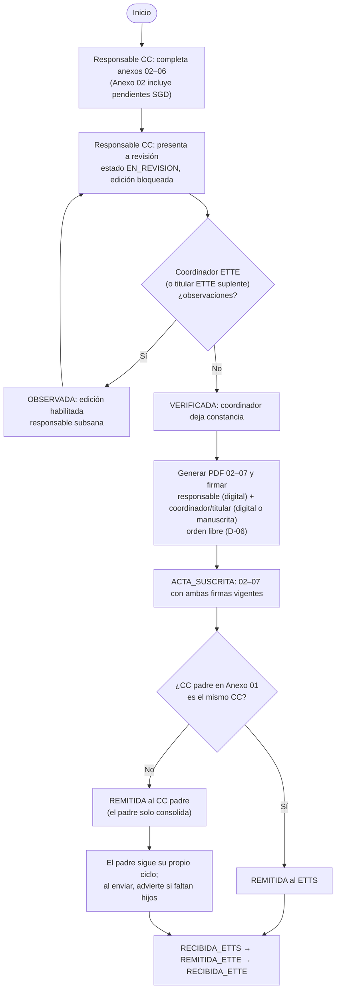

# Plan de adecuación del sistema a la Directiva N° 00X-2026-MDSJ/GM

**Fecha:** 2026-11-17
**Línea base:** [consolidado_directiva_transferencia_gestion.md](consolidado_directiva_transferencia_gestion.md) (requerimientos RF/RN/F citados por su ID).
**Código revisado:** rama `main` en `42f9b38`. Base local con el proceso 1 abierto, 206 dependencias activas y ninguna entrega registrada.

Este documento reúne el contexto, las decisiones tomadas y los cambios necesarios, ordenados por fases. Cada fase se puede desplegar sola y trae sus criterios de aceptación.

---

## 1. Decisiones de negocio

| ID | Decisión |
|---|---|
| D-01 | El **Anexo 01 se respeta tal cual**: 64 CC con código, descripción, nivel y CC padre, porque es el registrado oficialmente en CEPLAN (POI 2026). No se corrigen sus inconsistencias. |
| D-02 | **Ruteo:** cada CC envía a **su CC padre del Anexo 01**, sin considerar el nivel. Los CC cuyo padre es el mismo CC envían **directo al ETTS**. |
| D-03 | Se **eliminan los equipos de trabajo**: desaparecen el rol, el ruteo y la variante del acta firmada por el "Responsable del CC receptor". |
| D-04 | **Terminología:** el "delegado ETTE" del sistema es el **coordinador ETTE** de la directiva. Los **titulares ETTE** son el comité. Si el coordinador falta a la revisión de su CC, **firma un titular ETTE**. |
| D-05 | **Firma obligatoria de ambos lados en los anexos 02 al 07:** el responsable del CC y el coordinador ETTE (o, en su lugar, un titular ETTE). **Se elimina la constancia de ausencia ETTE.** |
| D-06 | **La firma no es secuencial.** (a) El coordinador puede firmar primero, de forma manuscrita (PDF escaneado) o digital, y el responsable firma digitalmente encima; con eso basta. (b) Si el responsable firma primero digitalmente, el coordinador **debe** firmar digitalmente, porque una firma manuscrita invalidaría la digital. Lo ideal es que ambos firmen digitalmente. |
| D-07 | **El ciclo de observaciones es obligatorio:** el coordinador observa, el responsable subsana y el coordinador vuelve a revisar. No se firma con observaciones abiertas. |
| D-08 | **El CC padre solo consolida:** no observa ni devuelve lo que envían sus hijos. Puede enviar aunque algún hijo no haya enviado; en ese caso el sistema muestra una advertencia y los hijos que falten envían después. |
| D-09 | **Anexo 02, sección IV (agenda pendiente):** combina la entrada libre con los **pendientes del SGD** de la dependencia. |
| D-10 | **Alta de coordinadores ETTE por dos vías:** formulario web y **plantilla Excel**. |
| D-11 | **Vinculación de datos:** una **tabla de equivalencias** relaciona cada dependencia del SGD o del SIGA con un CC del Anexo 01. Varias dependencias pueden apuntar al mismo CC. |
| D-12 | **Entran en esta etapa:** el envío ETTS → ETTE, el cálculo en días hábiles con el plazo CGR, el reemplazo de coordinador con constancia y el ajuste del Acta 07 (hora, lugar, "No aplica"). |

---

## 2. Situación actual (resumen de la revisión)

| Tema | Hoy | Brecha |
|---|---|---|
| Organigrama | Jerarquía del SGD con 206 nodos activos (158 del SGD y 48 del SIGA); nivel calculado por profundidad (1 al 6); incluye "ACTIVIDAD META", "CAJA CHICA", comités y nombres en `NULL`. Todo cuelga de Alcaldía `00001` ([migración](../../backend/database/migrations/2026_11_13_160000_unificar_raiz_organigrama_alcaldia.php)). | No hay código CEPLAN; los niveles no coinciden con el Anexo 01 (por ejemplo, la Oficina General de Administración tiene nivel 3 en el sistema y nivel 2 en el Anexo 01). |
| Envío | `remitirEntrega()` envía al `parent_id` del SGD; si no hay padre, el destino es `NULL` (ETTS) ([TransferenciaService.php](../../backend/app/Modules/Transferencia/Services/TransferenciaService.php)). | Un CC de nivel 2 llega al ETTS pasando por Gerencia Municipal y Alcaldía. |
| Revisión | La hace el responsable del CC padre (`revisarEntrega`: observar o consolidar), después del envío. | En la directiva revisa el coordinador ETTE, antes de firmar y antes de enviar. |
| Observaciones | Existen (enum `EstadoObservacion`, `ObservacionService`), pero el rol `delegado_ette` **no** tiene `observaciones.registrar`. | El coordinador no puede observar; la firma no comprueba si hay observaciones abiertas. |
| Firma | Firma Perú (PAdES) obligatoria solo del responsable del CC (`requisitosRemision`). El delegado firma de forma opcional: digital encadenada (`documento_previo_id`) o con un escaneo (`recibirManual`, estado `pendiente_validacion`). | No se puede firmar digitalmente sobre un escaneo; no se impide subir una firma manuscrita después de una digital; el titular ETTE no puede firmar (recibe 403); el acta queda "suscrita" solo con la firma del responsable. |
| Roles | `responsable_equipo`, `coordinador` y `delegado_ette` existen por separado ([Rol.php](../../backend/app/Support/Enums/Rol.php)). | Hay que quitar los equipos y unificar coordinador con delegado. |
| Pendientes del SGD | El módulo `Documentos` (`DocumentoPendiente`, con origen SGD o manual) se presenta como un "Anexo 01" con su propio PDF ([anexo01.blade.php](../../backend/resources/views/pdf/anexo01.blade.php)). | Ese nombre choca con el Anexo 01 de CC; el Anexo 02 no muestra los pendientes del SGD. |
| Delegados | Alta y asignación por web ([DelegadoService.php](../../backend/app/Modules/Auth/Services/DelegadoService.php)). | Falta la importación por Excel (el paquete de Excel ya está instalado y hoy solo se usa para exportar). |
| Cronograma | Bloquea el envío al vencer el plazo (`CronogramaService::exigirPlazoVigente`). | No calcula días hábiles ni feriados, ni la regla de 2 días hábiles antes del plazo CGR. |
| Acta 07 | Imprime el nivel del SGD; el receptor por defecto es el responsable del CC padre. | Faltan hora, lugar y "No aplica" (Anexo 06 y Otros); el receptor debe ser el coordinador o un titular ETTE. |
| ETTS → ETTE | El ETTE solo consulta. | No existen los estados recibido ETTS, enviado al ETTE ni recibido ETTE. |

---

## 3. Flujo objetivo



### 3.1 Máquina de estados de la entrega (una por CC y proceso)

| Estado | Entra cuando | Edición de anexos | Sale a |
|---|---|---|---|
| `borrador` | Inicio | Sí | `en_revision` |
| `en_revision` | El responsable presenta | No | `observada`, `verificada` |
| `observada` | El coordinador registra al menos una observación | Sí | `en_revision` (al volver a presentar, con todas las observaciones subsanadas) |
| `verificada` | El coordinador cierra la revisión sin observaciones abiertas | No | `acta_suscrita`, o `observada` si el coordinador reabre |
| `acta_suscrita` | Los anexos 02 al 07 tienen firma vigente de ambos lados | No | `remitida` |
| `remitida` | El responsable envía al CC padre o al ETTS | No | `recibida_etts` (solo si el destino es el ETTS) |
| `recibida_etts` | El ETTS registra la recepción | No | `remitida_ette` |
| `remitida_ette` | El ETTS envía al ETTE | No | `recibida_ette` |
| `recibida_ette` | El ETTE registra la recepción (estado final) | No | — |

Los estados `consolidada` y `cerrada` se retiran; los datos existentes se migran. Las firmas solo se habilitan en `verificada`. Si los datos cambian, la huella del documento invalida las firmas (mecanismo actual de `DocumentoFirma`) y el paquete vuelve a `borrador`.

Complemento hasta la fecha de cese (RF-26 y RF-68, F-17): **fuera del alcance de esta etapa**. Queda anotado como pendiente.

---

## 4. Modelo de datos (cambios)

**Estrategia para D-11:** los 64 CC se cargan **como filas de `dependencias`** con origen `ceplan`, y las dependencias del SGD y del SIGA se vinculan a ellos. Así se conservan todas las claves foráneas `dependencia_id` (anexos, firmas, entregas, asignaciones) y los cálculos de ámbito (`idsSubarbol`) pasan a recorrer el árbol del Anexo 01.

| Cambio | Detalle |
|---|---|
| `dependencias` | Nuevas columnas: `codigo_ceplan` (único por proceso), `nivel_ceplan` (1/2/3, solo informativo, para PDF y acta), `es_centro_costo` (bool), `envia_a_etts` (bool, verdadero cuando el padre es el mismo CC). Para los CC, `parent_id` = CC padre del Anexo 01, o `NULL` si el padre es el mismo CC. |
| `equivalencias_centro_costo` (nueva) | `dependencia_origen_id` (dependencia del SGD o del SIGA) → `centro_costo_id`; además `origen` (sgd/siga), `confirmada_por_id` y `confirmada_en`. Cada dependencia de origen tiene una sola equivalencia. |
| Dependencias del SGD y del SIGA | Siguen en la tabla para trazabilidad e ingesta, pero quedan fuera del flujo (`es_centro_costo = false`). El selector, el organigrama, el tablero y el envío solo muestran CC. |
| `entregas` | Nuevo conjunto de estados (ver 3.1); `destino` = `dependencia_destino_id` (CC padre) o `NULL` (ETTS); fechas `presentada_en`, `verificada_en`, `verificada_por_id`, `recibida_etts_en`, `remitida_ette_en`, `recibida_ette_en` (con usuario en cada caso); `hijos_pendientes_al_remitir` (json, para la advertencia de D-08). |
| `asignaciones_rol` | Se elimina `responsable_equipo` y se unifica `coordinador` en `delegado_ette`; la etiqueta pasa a ser **"Coordinador ETTE"** (el valor interno se puede mantener para no romper datos). Nuevas columnas: `acreditada_en`, `acreditada_por_id`, `reemplaza_a_id`, `motivo_reemplazo`. |
| `firmas_anexo` / `firma_sesiones` | Nuevo campo `lado` (`entidad` o `ette`) y `en_calidad_de` (`coordinador` o `titular_suplente`), con `motivo_suplencia` cuando firma un titular. La sesión manual pasa a contar como firma válida del lado ETTE (ver fase 4). |
| `observaciones` | Nuevo campo `ronda` (entero) y, cuando corresponda, la observación sobre el anexo completo (no solo sobre una fila), para documentos sin filas como el Anexo 02. |
| `feriados` (nueva) | `fecha`, `descripcion`, `alcance` (nacional/local). |
| `cronograma_actividades` | Nuevos campos `fecha_cgr` y `dias_habiles_antes` (por defecto 2). El vencimiento interno se calcula a partir de ellos. |
| `actas_transferencia` | Nuevos campos `lugar`, `hora`; `anexos_entregados` pasa a guardar `entregado`, `no_entregado` o `no_aplica` (este último solo para 06 y Otros); `otros_documentos` (texto). |
| `informes_gestion` | Sin cambio de estructura: los pendientes del SGD se leen en vivo y entran en la huella (fase 5). |

---

## 5. Fases

### Fase 0 — Preparación

1. Crear una rama `feature/directiva-2026`.
2. Instalar Laravel Boost (`composer require laravel/boost --dev && php artisan boost:install`), como pide `CLAUDE.md`/`AGENTS.md`, y leer las guías que genere.
3. Ejecutar la suite actual (`backend/tests/Feature`, unos 40 tests) y registrar la línea base.
4. Respaldar la base antes de cada migración de datos (ya existe `respaldo-antes-asignaciones.dump`; generar uno nuevo).

### Fase 1 — Catálogo del Anexo 01, equivalencias y envío (D-01, D-02, D-03, D-11)

Es la base de todas las demás fases.

**Backend**
- Seeder `CentrosCostoAnexo01Seeder` con los 64 CC del Anexo A del consolidado (código, descripción, nivel, padre). Los que tienen el padre igual a sí mismos (`01`, `02`, `03`, `04`, `05`, `06`, `07`…`17`) quedan con `parent_id = NULL` y `envia_a_etts = true`.
- Seeder `EquivalenciasCentroCostoSeeder` con una propuesta inicial: (1) por `codigo_siga`; (2) por nombre normalizado (sin tildes, mayúsculas, "OFICINA DE" ≈ "UNIDAD DE"); (3) los nodos de metas, cajas chicas y comités se asignan a su ancestro del SGD que ya tenga equivalencia. Todo lo que no se resuelva queda **sin asignar** para que el administrador lo revise.
- Endpoints de administración: `GET/PUT /api/centros-costo/equivalencias` (permiso `parametros.gestionar`) y un listado de dependencias sin asignar.
- Ingestas (`IngestaSgd`, `IngestaPatrimonioSiga`, `IngestaPersonalSgd`, `IngestaDocumentalSgd`, `AcervoSgdService`): al grabar, convertir `dependencia_origen → centro_costo` y guardar el `dependencia_id` del **CC**. Conservar la dependencia de origen en `fuente_referencia` para trazabilidad.
- `TransferenciaService::remitirEntrega()`: destino = `parent_id` del CC (que ya es el padre del Anexo 01) o `NULL` (ETTS) cuando `envia_a_etts` es verdadero.
- Responsable del CC: el encargado del SGD de la dependencia principal vinculada, con posibilidad de corregirlo a mano (RF-06).
- Retirar `Rol::RESPONSABLE_EQUIPO` y sus permisos; migrar sus asignaciones a `responsable_centro_costo` o revocarlas tras revisarlas con el usuario.

**Frontend**
- `EstructuraOrganicaPage` y `DependenciaSelector`: mostrar el árbol del Anexo 01 (código CEPLAN y nivel).
- Pantalla de administración de equivalencias: dependencia del SGD/SIGA → CC, con filtro "sin asignar".
- Quitar todas las referencias a "equipo de trabajo" (`AppLayout`, `InformeGestionPage`, `DespachoPersonalView`, `auth/permisos.ts`).

**Migración de datos:** reasignar al CC equivalente los registros de anexos que hoy apuntan a dependencias del SGD o del SIGA. Hoy no hay entregas, así que el riesgo es bajo.

**Criterios de aceptación**
- Hay exactamente 64 CC activos; el selector solo los muestra.
- 07.05 envía a 07; 07 envía al ETTS; 03.01 envía a 03; 06 envía al ETTS; 06.01 envía a 06; 11.02.01 envía a 11.02; 15.01 envía a 15 (F-14).
- Los bienes del SIGA de "UNIDAD DE CONTROL PATRIMONIAL" y "OFICINA DE GESTIÓN PATRIMONIAL" aparecen en el CC 11.05.
- Tests nuevos: `RuteoAnexo01Test` y `EquivalenciasCentroCostoTest`; adaptar `FlujoRemisionTest`, `CierreHaciaEttsTest`, `OrganigramaNavegacionTest` y `AutorizacionAmbitoTest`.

### Fase 2 — Coordinadores ETTE: roles, alta por web y Excel, reemplazo (D-04, D-10, D-12)

**Roles y permisos** ([Permiso.php](../../backend/app/Support/Enums/Permiso.php))
- `delegado_ette` pasa a llamarse **Coordinador ETTE** y se le agregan `observaciones.registrar` y un nuevo permiso `entregas.verificar`, ambos limitados a los CC asignados.
- Se elimina `Rol::COORDINADOR` y sus asignaciones se migran a `delegado_ette`.
- `Rol::ETTE` (titular): se le agregan `firmas.firmar` (solo como suplente), `observaciones.registrar` y `entregas.verificar` como suplente, y `entregas.recibir_ette`. La suplencia exige indicar el motivo (ausencia del coordinador) y queda auditada.
- `Rol::ETTS`: `entregas.recibir_etts` y `entregas.remitir_ette`.
- Se quitan `entregas.revisar` y `entregas.consolidar` del responsable del CC (D-08).

**Alta por web:** se mantiene [DelegadosPage.tsx](../../frontend/src/features/delegados/DelegadosPage.tsx). El selector de dependencia pasa a ser de CC (código CEPLAN).

**Alta por Excel**
- `GET /api/delegados/plantilla`: descarga una plantilla `.xlsx` con las columnas `DNI`, `Apellidos`, `Nombres`, `Correo`, `Celular`, `Código CC (Anexo 01)` y `Observación`, y una hoja de consulta con los 64 CC.
- `POST /api/delegados/importar?modo=previsualizar` devuelve el resultado fila por fila (`crear_usuario`, `asignar`, `ya_asignado` o `error`, con el motivo). `modo=confirmar` aplica todo en una sola transacción.
- Validaciones: DNI de 8 dígitos; el CC existe y está activo; no hay filas repetidas (DNI + CC) en el archivo; un DNI que existe en el padrón usa su cuenta y uno que no existe crea un usuario externo (se reutiliza `DelegadoService::crearExterno`); se avisa si el CC ya tiene coordinador.
- Clases nuevas: `App\Modules\Auth\Excel\DelegadosImport`, `DelegadosPlantillaExport` y `ImportacionDelegadosService`. En el frontend, un modal de carga con la tabla de previsualización.

**Reemplazo de coordinador (RF-15, RN-12, F-12)**
- `POST /api/delegados/{id}/reemplazar` recibe el nuevo coordinador y el motivo. Revoca la asignación anterior, crea la nueva con `reemplaza_a_id` y genera una **constancia PDF**. Las firmas y observaciones del coordinador anterior se conservan; los plazos no se modifican.
- Notificación dentro del sistema al responsable del CC (bandeja o aviso en el inicio). Por correo, solo si ya existe un canal configurado.
- `GET /api/delegados/relacion/pdf`: relación de coordinadores acreditados (RF-13).

**Criterios de aceptación:** se importa una plantilla con 10 filas válidas y 2 erróneas, la previsualización muestra las 2 con su motivo y solo se aplican las válidas; un reemplazo deja constancia y no cambia ninguna fecha del cronograma. Tests: `ImportacionDelegadosTest`, `ReemplazoCoordinadorTest`; adaptar `DelegadoGestionTest` y `DelegadoEtteAmbitoTest`.

### Fase 3 — Revisión del coordinador y observaciones (D-07, D-08)

**Backend**
- Nuevos endpoints en `TransferenciaController`:
  - `POST /api/transferencia/presentar` (responsable): de `borrador` u `observada` a `en_revision`. Si quedan observaciones sin subsanar, responde 409.
  - `POST /api/transferencia/verificar` (coordinador o titular suplente): de `en_revision` a `verificada`. Responde 409 si quedan observaciones abiertas. Registra la constancia de verificación (RF-54) y lo que se verificó y lo que no (RF-56, campo de texto).
  - Registrar una observación sobre un CC en `en_revision` cambia la entrega a `observada` (hoy son dos acciones separadas; se unifican) y aumenta la `ronda`.
  - `POST /api/transferencia/reabrir` (coordinador): de `verificada` a `observada`, solo si todavía no hay firmas.
- `ObservacionService`: retirar `reRemitirSiCorresponde` (la vuelta a revisión pasa a ser explícita con "presentar"); permitir observar el anexo completo.
- Eliminar `revisarEntrega` (observar o consolidar del CC padre) y el `VistoBuenoDelegado`: la verificación lo reemplaza. Conservar los datos históricos (solo lectura).
- `RespetaEstadoEntrega`: solo se edita en `borrador` y `observada`.
- RF-55: `GET /api/reportes/verificacion` para el comité ETTE, con el resultado por CC (faltantes, inconsistencias y observaciones pendientes).

**Frontend**
- Portal del coordinador: bandeja de CC asignados en `en_revision`, formulario de observación por anexo o fila, y botón "Verificar sin observaciones".
- Portal del responsable: botón "Presentar a revisión" y lista de observaciones por subsanar, con su ronda.
- Retirar `BandejaRevisorView` (revisión del CC padre).

**Criterios de aceptación:** F-03, F-04, F-05 y F-06 del consolidado. El responsable del CC padre no puede observar a sus hijos (403). Tests: `RevisionCoordinadorTest`; adaptar `ObservacionesTest`, `BloqueoEdicionTrasRemitirTest` y `VistoBuenoDelegadoTest` (este último se elimina o se convierte).

### Fase 4 — Firma con ambos lados obligatorios y sin orden (D-04, D-05, D-06)

**Reglas**
1. Cada documento 02–07 necesita **una firma vigente del lado entidad** (responsable del CC, siempre digital con Firma Perú) y **una firma vigente del lado ETTE** (coordinador asignado o titular ETTE suplente, digital o manuscrita según la regla 3).
2. Solo se firma en estado `verificada`.
3. **Orden libre, con estas restricciones** (D-06):
   - *ETTE primero, manuscrita:* el coordinador descarga el PDF generado, lo firma a mano y sube el escaneo. El escaneo queda como **documento base**, y el responsable firma digitalmente sobre ese escaneo. La cadena se reconoce porque la sesión del responsable apunta al escaneo (`documento_previo_id`) y este, a su vez, al PDF generado vigente (se registra su huella al subirlo). No se verifica criptográficamente el escaneo: la firma digital del responsable encima lo convalida (decisión del usuario).
   - *ETTE primero, digital:* el responsable firma sobre el PDF ya firmado (cadena actual).
   - *Entidad primero (digital):* el lado ETTE **solo puede firmar digitalmente** sobre ese PDF. Se **rechaza la subida manuscrita** (409: "Ya existe una firma digital; la firma del coordinador debe ser digital para no invalidarla").
   - Ambas firmas deben pertenecer a **la misma cadena** (un único PDF final con las dos). Dos cadenas paralelas no cumplen el requisito.
4. Se elimina la **constancia de ausencia ETTE** (`ConstanciaAusenciaController`, `firmas.constancia_ausencia`, `EstadoFirma::AUSENTE`, `ConstanciaAusenciaEtte.tsx`). Sus registros históricos se conservan como lectura.
5. Pasa a `acta_suscrita` cuando los seis documentos cumplen las reglas 1 y 3. El estado del acta (`suscrita`) exige las dos firmas.

**Cambios en el código**
- `FirmaperuRegistroService::caracter()` → reemplazar el carácter opcional/obligatorio por el `lado` (entidad o ETTE). El lado ETTE se admite para el coordinador asignado a ese CC o para un titular ETTE (con motivo de suplencia). Ya no hay firma opcional.
- `FirmaperuRegistroService::requisitosRemision()` → comprueba los dos lados en la misma cadena vigente y devuelve lo pendiente por documento y por lado.
- `FirmaperuSesionService::recibirManual()` → (a) rechazar si ya existe una firma digital vigente en la cadena; (b) dejar la sesión como `firmada` con origen `manual` (base de la cadena), sin verificación criptográfica; (c) se mantiene su huella SHA-256.
- `FirmaperuSesionService::preparar()` y `FirmaperuRegistroService::provieneDelGenerado()` → aceptar como eslabón válido una sesión manual cuyo `original_sha256` coincida con el PDF generado vigente.
- `CaracterFirma` se retira o se reemplaza por un enum `LadoFirma`. Hay que actualizar `versionarActaPorCorreccion` para que también anule las firmas del lado ETTE.
- Frontend: `PdfFirmaPage`, `BotonFirmaPeru` y `MiniEstadoFirma` muestran dos casillas por documento (Entidad / ETTE), indican quién firmó y en qué calidad, y ocultan "Subir firma manuscrita" cuando ya hay una firma digital.

**Criterios de aceptación:** las 4 combinaciones de orden (ETTE manuscrita → entidad, ETTE digital → entidad, entidad → ETTE digital, entidad → intento de ETTE manuscrita, que se rechaza); la firma de un titular suplente con motivo; no se puede enviar con un solo lado firmado; si se edita un dato después de firmar, se invalidan ambas firmas. Tests: adaptar `FirmaperuSubirManualTest`, `FirmaperuFlujoInstitucionalTest`, `GateFirmaActaRemisionTest` y `FirmaAnexoTest`; eliminar `ConstanciaAusenciaEtteTest`.

### Fase 5 — Anexo 02 con pendientes del SGD (D-09)

- `GestionService::datos()`: la sección IV combina `pendientes_items` (entrada manual) con los `DocumentoPendiente` del CC (origen SGD, todas las dependencias de origen vinculadas). Correspondencia de columnas: *Asunto* ← asunto o sumilla; *Estado y acción requerida* ← estado del SGD y justificación; *Documento o expediente* ← número de documento o expediente; *Plazo* ← fecha límite, si existe; *Unidad competente* ← dependencia de destino. Cada fila indica su origen (SGD o manual).
- La huella del Anexo 02 (`FirmaperuPdfService::huella`) incluye los pendientes del SGD, de modo que un cambio en el SGD exige generar de nuevo el PDF y volver a firmar. Para que el documento no cambie durante la revisión, los pendientes se **congelan** al presentar (`en_revision`) en una copia fija dentro de `informes_gestion`. Antes de presentar, se pueden actualizar con un botón "Actualizar pendientes del SGD".
- Se retira el "Anexo 01 – Documentos pendientes" como anexo independiente: se quita del menú, de `presenciaAnexos()` (`anexo_01`), del paquete PDF y de `anexo01.blade.php`. La pantalla `DocumentosPage` puede quedar como "Pendientes SGD" (consulta y detalle) enlazada desde el Anexo 02.
- Criterios: el PDF del Anexo 02 muestra los pendientes del SGD y los manuales; si cambia un pendiente del SGD antes de presentar, el PDF se actualiza; después de presentar, queda fijo. Tests: `InformeGestionPdfTest` y `DocumentoPendienteSumillaTest`.

### Fase 6 — Consolidación del CC padre y cadena ETTS → ETTE (D-08, D-12)

- **Consolidación:** la vista "Consolidado" del CC padre (ya existe en `AnexosEntidadPage`) muestra sus anexos y los de su subárbol, con el **autor y el CC de origen** de cada elemento (RF-43). El padre no cambia los datos de sus hijos.
- **Advertencia al enviar:** `remitirEntrega()` calcula los hijos directos que aún no han enviado. Si hay alguno, la respuesta exige `confirmar_sin_hijos=true` y guarda la lista en `hijos_pendientes_al_remitir`. Un hijo puede enviar después aunque su padre ya haya enviado; en ese caso el tablero lo marca como "enviado tarde".
- **ETTS:** bandeja con los CC enviados al ETTS (`envia_a_etts`), acción "Registrar recepción" (`recibida_etts`) y acción "Enviar al ETTE" (por CC o en lote) que genera una constancia de entrega (RF-75).
- **ETTE:** bandeja de recepción con la acción "Registrar recepción" (`recibida_ette`), que cierra el flujo.
- Expediente (`ExpedientePdf`): incluir el Acta 07 firmada y los PDF firmados finales, no solo los borradores.
- Criterios: F-08, F-09, F-10 y F-11. Tests: `CadenaEttsEtteTest` y adaptar `CierreHaciaEttsTest`.

### Fase 7 — Cronograma en días hábiles y plazo CGR (D-12)

- Tabla `feriados` con su CRUD (permiso `cronograma.gestionar`) y una semilla con los feriados nacionales de 2026 y 2027.
- Servicio `CalendarioHabil` con `restarDiasHabiles(fecha, n)` y `esHabil(fecha)` (lunes a viernes, excluyendo feriados).
- `CronogramaActividad`: si tiene `fecha_cgr`, el vencimiento interno es `fecha_cgr − dias_habiles_antes` (por defecto 2) en días hábiles; si no, se usa la fecha manual actual.
- Actividades 3 (verificación) y 4 (acta): el bloqueo se aplica a **presentar**, **verificar**, **firmar** y **enviar** (hoy solo bloquea el envío). La sustitución de un coordinador no altera ningún vencimiento.
- Tablero: indicador de "vence en N días hábiles" y "vencido" por CC (F-16). Las alertas por correo quedan fuera de esta etapa.
- Tests: `CalendarioHabilTest` (cruce de feriado y fin de semana) y adaptar `CronogramaBloqueoTest`.

### Fase 8 — Acta 07 conforme al formato

- [acta.blade.php](../../backend/resources/views/pdf/acta.blade.php) y `ActaPdf`: cabecera con el CC, la **clasificación y nivel del Anexo 01**, y la unidad de la que depende (el CC padre); apertura con lugar (San Jerónimo, Cusco), día, mes, año y **hora**; sección II con el coordinador ETTE o el titular suplente (sin la opción "CC receptor"); sección III con las opciones Entregado / No entregado / **No aplica** (esta última solo para el 06 y Otros), editables antes de firmar; sección IV con las observaciones (las de las rondas cerradas, como constancia) y comentarios adicionales; nota fija de que no sustituye el acta de la CGR (RF-67).
- `ActaPage`: formulario para lugar, hora, condición por anexo y otros documentos. La condición por defecto sale de la presencia de registros.
- Tests: `ActaTransferenciaTest` y `PdfPresentacionTest`.

### Fase 9 — Tablero, reportes y cierre

- `TransferenciaService::obtenerTableroOperativo()`: contar por los estados nuevos, por nivel del Anexo 01, con plazos y con observaciones abiertas por ronda (RF-90).
- Reportes Excel (`MatrizAnexosExport`, `ObservacionesExport`): agregar las columnas de código CEPLAN y estado nuevo.
- Actualizar `docs/nuevos-requerimientos` o archivarlo, y marcar los estados ✅/🟡/❌ en el consolidado.
- Hacer un ensayo completo con datos reales en un entorno de prueba antes del despliegue, como el de [despliegue-produccion-2026-11.md](../documentacion-firma/despliegue-produccion-2026-11.md).

---

## 6. Orden y dependencias

```
F0 → F1 → F2 → F3 → F4 → F6 → F9
            ↘ F5 (después de F1; antes de F4, porque cambia la huella del Anexo 02)
            ↘ F7 (independiente, después de F3)
            ↘ F8 (después de F4)
```

F1 es bloqueante: el ámbito, el envío y los datos dependen del catálogo de CC. F3 y F4 cambian el núcleo del flujo y conviene desplegarlas juntas.

---

## 7. Riesgos

| Riesgo | Mitigación |
|---|---|
| Equivalencias SGD/SIGA → CC incompletas o erróneas: bienes o documentos que caen en el CC equivocado | Revisión manual obligatoria de las que quedan sin asignar; reporte de diferencias antes y después de reasignar; respaldo previo. |
| La reasignación de datos invalida PDF y firmas ya generados | Hoy no hay entregas; ejecutar F1 antes de que empiece el uso real. |
| Un escaneo con firma manuscrita no se puede verificar | Aceptado por decisión: la firma digital del responsable encima lo convalida; se guardan la huella y el usuario que lo subió. |
| Pendientes del SGD que cambian durante la firma | Se congelan al presentar a revisión (fase 5). |
| Quitar `revisarEntrega`, el visto bueno y la constancia de ausencia rompe pantallas actuales | Retirarlos junto con las pantallas nuevas (F3 y F4 en el mismo despliegue); conservar los datos históricos como solo lectura. |

---

## 8. Puntos aún abiertos (no bloquean el inicio)

1. **Valor del plazo CGR** por actividad y si hay varios hitos (V-09): lo carga el ETTS en el cronograma.
2. **Catálogos:** estado B/R/M del Anexo 06 (se asume Bueno/Regular/Malo), estado del bien en el Anexo 04, régimen, modalidad y situación en el Anexo 05 (V-13, V-14).
3. **Motivo de la entrega de cargo** (cese, cambio, fin de gestión) como dato del proceso o del CC (V-11).
4. **Responsable del CC impedido** (FA-02 y V-12): quién firma en su lugar. Se propone registrar un encargado mediante una asignación temporal hecha por el ETTS.
5. **Inconsistencias patrimoniales de Gestión Patrimonial** (RF-81) y **devolución de bienes del personal contratado** (RF-83, F-19): no entran en esta etapa.
6. **Complemento hasta la fecha de cese** (RF-26, F-17): no entra en esta etapa.
